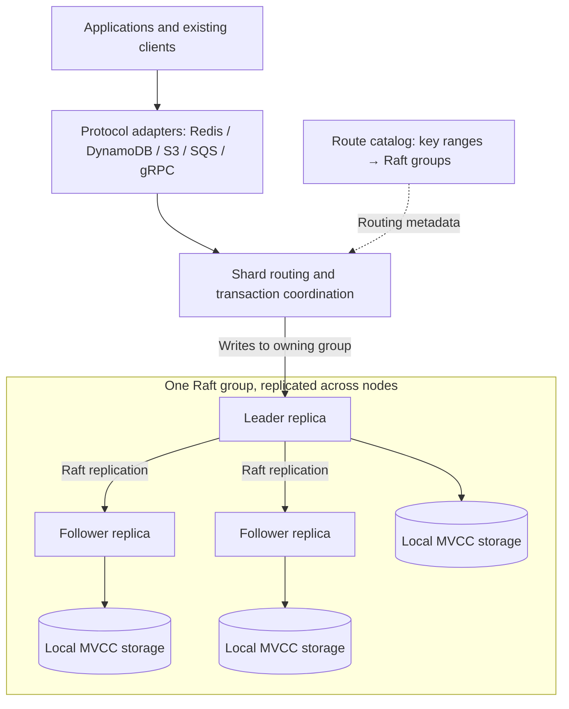
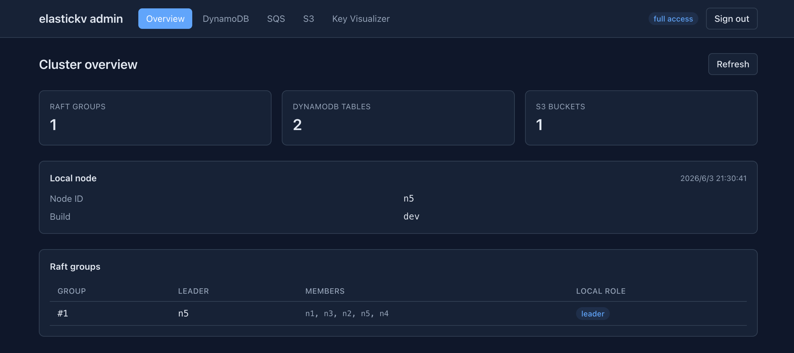
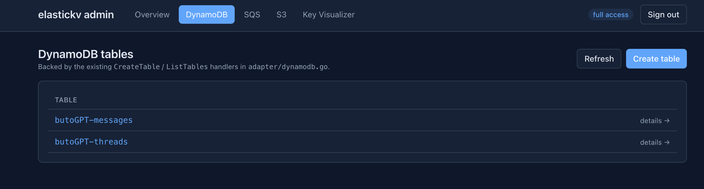
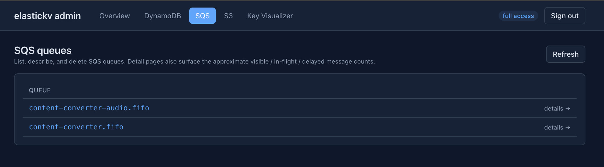
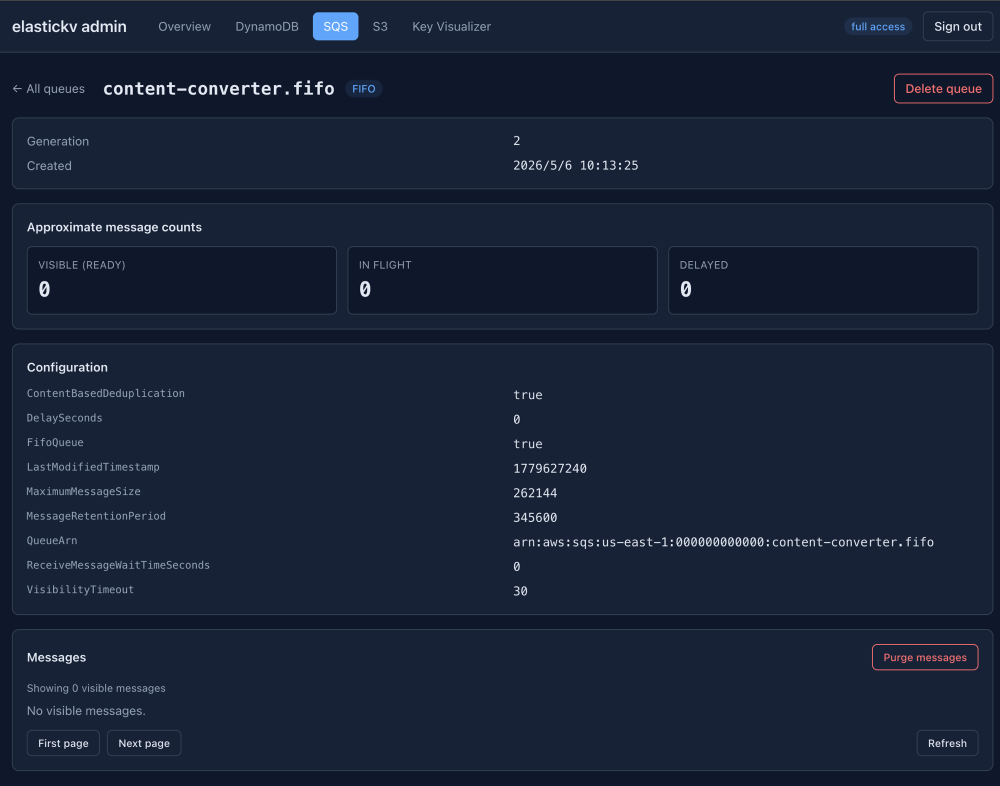
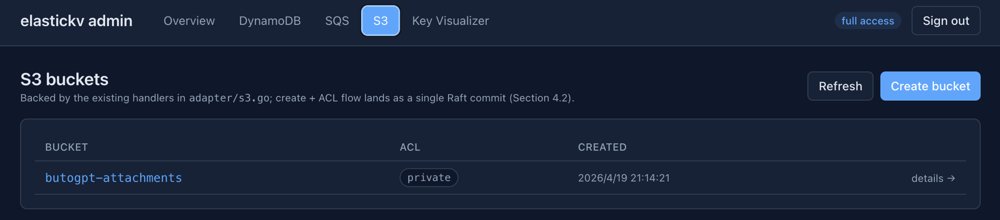

# Elastickv

## Overview

Elastickv is a self-hosted distributed store for applications built around Redis and AWS-style storage APIs.
It provides Redis-compatible key-value operations, DynamoDB-style tables, S3-style objects, and SQS-style queues on infrastructure you operate, backed by a shared Raft-replicated storage engine.

## What you can use it for

- **Run applications on-premises:** provide the Redis and AWS-style storage APIs your application uses from a cluster in your own data center, with data stored on machines you control.
- **Keep application storage at the edge:** serve tables, objects, queues, and key-value data on-site, alongside the application that uses them, where connectivity to AWS may be limited.
- **Operate inside an air-gapped network:** provide supported storage APIs within an isolated environment where applications cannot reach AWS service endpoints.

One server binary per node provides these APIs, so you can operate them as one storage cluster instead of deploying a separate server for each API.
A typical replicated deployment uses three to five machines; timestamp allocation and shard routing are built in, with no separate timestamp or placement service to operate.

Each API implements a documented subset of its upstream protocol. Sharing the storage engine does not make records interchangeable across APIs or provide a transaction spanning Redis, DynamoDB, S3, and SQS requests. Validate the operations your application needs before adopting it.

Elastickv can be used in production. See [Production deployment](#production-deployment) for replicated deployment and operations guides.

Start with the [quick start](#quick-start), or use the [Docker instructions](docs/getting_started.md#docker-alternative) if you prefer a container.

## Quick start

Run a persistent single-node instance locally, then write and read your first key.
You need Git, Go 1.26 or later, `curl`, and `redis-cli`.
The toolchain selected in [`go.mod`](go.mod) may be downloaded automatically during the build.
Run these commands in a terminal (for an existing checkout, start at `go build`):

```bash
git clone --recurse-submodules https://github.com/bootjp/elastickv.git
cd elastickv
go build -o elastickv .
./elastickv \
  --address 127.0.0.1:50051 \
  --redisAddress 127.0.0.1:6379 \
  --dynamoAddress 127.0.0.1:8000 \
  --metricsAddress 127.0.0.1:9090 \
  --healthAddress 127.0.0.1:8081 \
  --pprofAddress= \
  --raftId n1 \
  --raftDataDir .cache/quickstart-data \
  --raftBootstrap
```

Leave the server running. In a second terminal, wait for readiness, then check Redis:

```bash
curl --fail http://127.0.0.1:8081/readyz
redis-cli -h 127.0.0.1 -p 6379 SET greeting hello
# OK
redis-cli -h 127.0.0.1 -p 6379 --raw GET greeting
# hello
```

Readiness can return HTTP 503 during the initial election; retry after a few seconds.
Stop with Ctrl+C. To restart, use the same command **without `--raftBootstrap`**, keeping the same node ID and data directory.
A single node has no replica redundancy. These unauthenticated local endpoints are for evaluation on a trusted machine.

For Docker, persistence checks, S3/SQS setup, and troubleshooting, follow the [Getting started guide](docs/getting_started.md).
For a replicated deployment, choose [Kubernetes](docs/kubernetes.md) or [multiple VMs with Docker](docs/docker_multinode_manual_run.md).

## Architecture

Elastickv presents several APIs over a shared sharded KV engine.
The routing layer selects the Raft group that owns a key range; each data group replicates its own log and applies committed changes to local MVCC storage.



A node can host replicas for multiple Raft groups.
The route catalog is itself persisted through the default Raft group; nodes cache it for routing.
The diagram shows the write path for one group; read paths and optional services are expanded in the architecture overview.
Protocol adapters translate requests into KV operations; compatibility is limited to the supported operations listed below.
The optional FUSE mount also uses this KV engine.
See the [architecture overview](docs/architecture_overview.md) for component details, cluster topology, and timestamp handling.

## Implemented Features
- **Raft-based Data Replication**: KV state replication is implemented on Raft, with leader-based commit and follower forwarding paths.
- **Shard-aware Data Plane**: Static shard ranges across multiple Raft groups with shard routing/coordinator are implemented.
- **Route Management and Load Distribution**: A durable route catalog, versioned route snapshots, watcher-based refresh, and manual `ListRoutes`/`SplitRange` are implemented. Opt-in `--autoSplit` detects hot ranges and splits them within the same Raft group. The additional `--autoSplitCrossGroup` flag can migrate an eligible hot right child to another configured group when migration readiness and target-load checks pass; see the [automation design and limits](docs/design/2026_06_11_implemented_hotspot_split_milestone3_automation.md). Opt-in `--leaderBalance` distributes Raft-group leadership among existing voters.
- **Protocol Adapters**: gRPC (`RawKV`/`TransactionalKV`), Redis-compatible server, DynamoDB-compatible HTTP API, S3-compatible HTTP API, and SQS-compatible HTTP API implementations are available (runtime exposure depends on the selected server entrypoint/configuration). The public gRPC `TransactionalKV` service supports single-key operations; its `PreWrite`, `Commit`, and `Rollback` RPCs are not implemented.
- **Redis Compatibility Scope**: Strings, hashes, lists, sets, sorted sets, HyperLogLog, streams (`XADD`/`XREAD`/`XRANGE`/`XREVRANGE`/`XTRIM`/`XLEN`), Pub/Sub (`PUBLISH`/`SUBSCRIBE`), transactions (`MULTI`/`EXEC`/`DISCARD`), TTL/expiry (`EXPIRE`/`PEXPIRE`/`TTL`/`PTTL`), key scanning (`KEYS`/`SCAN`), and Lua scripting (`EVAL`/`EVALSHA`) are implemented. A Redis-protocol reverse proxy (`cmd/redis-proxy`) supports phased migration with dual writes and shadow-read comparison; validate command coverage and cutover behavior for your workload.
- **DynamoDB Compatibility Scope**: `CreateTable`/`DeleteTable`/`DescribeTable`/`ListTables`/`PutItem`/`GetItem`/`DeleteItem`/`UpdateItem`/`Query`/`Scan`/`BatchWriteItem`/`TransactWriteItems`/`TransactGetItems` are implemented.
- **S3 Compatibility Scope**: Bucket and object operations, bucket-level `private`/`public-read` ACLs, and multipart uploads are implemented for path-style requests. AWS Signature Version 4 authentication with static credentials is supported. The server exposes this endpoint via `--s3Address`.
- **SQS Compatibility Scope**: Standard and FIFO queues support queue management, send/receive/delete (including batch operations), visibility timeouts, long polling, tags, and routing to a dead-letter queue through `RedrivePolicy`. JSON and Query/XML request protocols are supported. The public endpoint is opt-in via `--sqsAddress` and supports static SigV4 credentials.
- **FUSE Filesystem**: An opt-in mount (`--filesystemMount`) exposes regular files and directories backed by the sharded KV store. It supports offset reads/writes, sparse files, truncation, directory listing, same-directory rename, and unlink while a file is open. File data uses fixed-size chunks placed on one home shard per file in normal operation; see [Working with the FUSE filesystem](#working-with-the-fuse-filesystem) for setup and limits. All enabled mounts use strict operation journaling; legacy mode is retired.
- **Backup and Encryption Operations**: Live point-in-time logical backup and offline snapshot conversion tools are available. Opt-in storage and Raft envelope encryption paths are implemented, while the overall encryption design remains partial. See the [backup runbook](docs/operations/backup_restore.md) and [encryption status](docs/design/2026_04_29_partial_data_at_rest_encryption.md) before operating these features.
- **Basic Consistency Behaviors**: Write-after-read checks, leader redirection/forwarding paths, and OCC conflict detection for transactional writes are covered by tests.
- **Timestamp Issuance**: The default path uses a 64-bit hybrid logical clock (HLC) with a Raft-committed physical-time ceiling. An optional dedicated group-0 timestamp oracle supports staged `legacy`, `shadow`, `cutover`, and `phase-d` modes; see [Centralized TSO Operations](docs/centralized_tso_operations.md).

## Planned Features
- **Dynamic Node Scaling**: Adding/removing nodes and groups automatically based on load is not yet implemented.
- **General Range Relocation**: Cross-group auto-split is limited to eligible right-child migrations. Moving an arbitrary existing range, including an isolated single-key range, remains future work; see the [automation design](docs/design/2026_06_11_implemented_hotspot_split_milestone3_automation.md).

## Production deployment

Use [Kubernetes](docs/kubernetes.md) or the [multi-VM Docker runbook](docs/docker_multinode_manual_run.md) to deploy persistent voting replicas across independent hosts.
Three voters tolerate one voter failure; five tolerate two.
The local quick start runs a single node to make the first read and write easy to try.

The deployment guides cover private networking, persistent storage, cluster bootstrap, and verification.
Use the [monitoring guide](monitoring/README.md) for operational visibility and the [backup and restore runbook](docs/operations/backup_restore.md) to protect stored data.
Protocol and POSIX compatibility follow the documented operation scope.

## Example Usage

This section provides sample commands to demonstrate how to use the project. Make sure you have the necessary dependencies installed before running these commands.

### Starting the server and client

Use the [quick start](#quick-start) for a local persistent server.
The [Getting started guide](docs/getting_started.md) covers restart, Docker, optional S3/SQS listeners, and the separate three-node demo.
The root entrypoint (`go run .` or `go build -o elastickv .`) is the normal server; `cmd/server` is a development demo.

`etcd/raft` is the only supported Raft engine.
For stores from the removed HashiCorp backend, consult the [historical migration runbook](docs/etcd_raft_migration_operations.md) before opening the data directory.

### Working with Redis
To start the Redis client:
```bash
redis-cli -p 6379
```

The separate three-node demo (`go run ./cmd/server/demo.go`) uses Redis ports `63791`–`63793`.

#### Setting and Getting Key-Value Pairs
To set a key-value pair and retrieve it:
```bash
set key value
get key
quit
```

#### Sorted Sets, Streams, and Other Data Structures
The Redis adapter implements operations on sorted sets (`ZADD`/`ZRANGE`/`ZSCORE`), HyperLogLog (`PFADD`/`PFCOUNT`), streams (`XADD`/`XREAD`/`XRANGE`), sets (`SADD`/`SMEMBERS`), hashes (`HGET`/`HSET`/`HGETALL`), and Pub/Sub (`PUBLISH`/`SUBSCRIBE`). Lua scripts can be executed via `EVAL` and `EVALSHA`.

#### Migrating from Redis

A Redis-protocol reverse proxy (`redis-proxy`) supports phased migration for its supported commands. It supports dual-write, shadow-read comparison, and primary cutover modes. See the [proxy deployment guide](docs/redis-proxy-deployment.md) for supported commands, validation, and cutover steps.

```bash
# Run redis-proxy in dual-write mode (writes to both Redis and Elastickv)
# The proxy listens on :6479 inside the container, exposed as :6379 on the host
# so existing clients can connect without changing their configuration.
docker run --rm \
  -p 6379:6479 \
  ghcr.io/bootjp/elastickv/redis-proxy:latest \
  -listen :6479 \
  -primary redis.internal:6379 \
  -secondary elastickv.internal:6380 \
  -elastickv-pool-size 192 \
  -secondary-write-concurrency 96 \
  -secondary-script-concurrency 3 \
  -secondary-blocking-replay-concurrency 32 \
  -mode dual-write
```

### Working with SQS-compatible Queues

Set `--sqsAddress` and `--sqsCredentialsFile` on the server as shown in the [Getting started guide](docs/getting_started.md#enable-s3-and-sqs), then use matching AWS CLI credentials and region:

```bash
export AWS_ACCESS_KEY_ID=YOUR_ACCESS_KEY
export AWS_SECRET_ACCESS_KEY=YOUR_SECRET_KEY
export AWS_DEFAULT_REGION=us-east-1
unset AWS_SESSION_TOKEN AWS_PROFILE
aws --endpoint-url http://localhost:9324 --region us-east-1 sqs create-queue \
  --queue-name jobs
aws --endpoint-url http://localhost:9324 --region us-east-1 sqs list-queues
```

Standard and FIFO queues support the JSON and Query/XML SQS protocols. See the [SQS adapter design](docs/design/2026_04_24_implemented_sqs_compatible_adapter.md) for the supported operation list and limitations.

### Working with S3-compatible Storage

Elastickv exposes an S3-compatible HTTP API when `--s3Address` is set (for example `127.0.0.1:9000`). Use a client configured for path-style requests, AWS Signature Version 4, and the operations this adapter supports. Follow the [Getting started guide](docs/getting_started.md#enable-s3-and-sqs) to enable the listener and configure matching credentials.

```bash
# Use credentials matching the local server in this shell
export AWS_ACCESS_KEY_ID=YOUR_ACCESS_KEY
export AWS_SECRET_ACCESS_KEY=YOUR_SECRET_KEY
export AWS_DEFAULT_REGION=us-east-1
unset AWS_SESSION_TOKEN AWS_PROFILE

# Create a bucket
aws --endpoint-url http://localhost:9000 s3api create-bucket --bucket my-bucket

# Create and upload an object
printf 'hello\n' > /tmp/elastickv-hello.txt
aws --endpoint-url http://localhost:9000 s3api put-object \
  --bucket my-bucket --key hello.txt --body /tmp/elastickv-hello.txt

# Download an object
aws --endpoint-url http://localhost:9000 s3api get-object \
  --bucket my-bucket --key hello.txt /tmp/hello.txt

# List objects
aws --endpoint-url http://localhost:9000 s3api list-objects-v2 \
  --bucket my-bucket
```

#### Public Bucket Access

Buckets support a bucket-level ACL that allows anonymous (unauthenticated) read access. Supported canned ACL values are `private` (default) and `public-read`.

```bash
# Create a public bucket
aws --endpoint-url http://localhost:9000 s3api create-bucket \
  --bucket public-assets --acl public-read

# Change an existing bucket to public
aws --endpoint-url http://localhost:9000 s3api put-bucket-acl \
  --bucket my-bucket --acl public-read

# Check a bucket's ACL
aws --endpoint-url http://localhost:9000 s3api get-bucket-acl \
  --bucket my-bucket

# Upload hello.txt to the public bucket
aws --endpoint-url http://localhost:9000 s3api put-object \
  --bucket public-assets --key hello.txt --body /tmp/elastickv-hello.txt
# Download anonymously (no credentials required)
curl http://localhost:9000/public-assets/hello.txt

# Revert both example buckets to private
aws --endpoint-url http://localhost:9000 s3api put-bucket-acl \
  --bucket my-bucket --acl private
aws --endpoint-url http://localhost:9000 s3api put-bucket-acl \
  --bucket public-assets --acl private
```

Public buckets allow unauthenticated `GetObject`, `HeadObject`, `HeadBucket`, and `ListObjectsV2`. Write operations (`PutObject`, `DeleteObject`, multipart uploads) always require authentication. `ListBuckets` and ACL management also always require authentication.

See `docs/design/2026_03_22_implemented_s3_compatible_adapter.md` for the full data model, consistency guarantees, multipart upload design, and rollout plan. See `docs/design/2026_04_01_implemented_s3_public_bucket.md` for the public bucket ACL design.

### Working with the FUSE filesystem

On a host with FUSE support, stop the quick-start server first, create a mount directory, and start a separate experiment with a fresh `.cache/fuse-data` directory:

```bash
mkdir -p /tmp/elastickv-mount
go run . \
  --address "127.0.0.1:50051" \
  --redisAddress "127.0.0.1:6379" \
  --dynamoAddress "127.0.0.1:8000" \
  --pprofAddress= \
  --raftId "n1" \
  --raftDataDir .cache/fuse-data \
  --raftBootstrap \
  --filesystemMount "/tmp/elastickv-mount" \
  --filesystemRootUID "$(id -u)" \
  --filesystemRootGID "$(id -g)"
```

In another terminal, use normal file commands:

```bash
mkdir /tmp/elastickv-mount/docs
printf 'hello\n' > /tmp/elastickv-mount/docs/hello.txt
cat /tmp/elastickv-mount/docs/hello.txt
```

On subsequent starts, keep `.cache/fuse-data` and omit `--raftBootstrap`.

The root owner and mode flags apply when the filesystem root is first created; the defaults are UID/GID `0` and mode `0755`, and the mount enforces `default_permissions`, so set them to the user that will write to the mount. `--filesystemClientID` defaults to `--raftId` and identifies open-handle leases. `--filesystemCapacity` and `--filesystemMaxFiles` set values reported by `statfs`; they do not enforce write quotas. The server mounts through `fusermount3` (package `fuse3`) after its network listeners are up. The server unmounts the filesystem on a clean stop, including `SIGTERM`/`SIGINT`. After `SIGKILL` or a crash, confirm the old process has stopped, then restart with the same client ID and `--filesystemStrictRecover` to reconcile the previous journal session. Startup also detaches a stale kernel mount when necessary. See the [FUSE filesystem guide](docs/filesystem.md) for details.

This FUSE implementation supports regular files and directories, but not cross-directory rename, hard links, symbolic links, extended attributes, or full POSIX locking. Concurrent mutations use optimistic concurrency, with bounded internal retries for definitive conflicts on the integrated paths. Exhausted contention budgets return `EBUSY`; other paths can still return `EAGAIN`, while unknown outcomes return `EIO`. Do not replay a non-idempotent operation after an unknown outcome, and never retry `close` on the same descriptor. Cross-mount `O_APPEND` is not atomic; use one writer or one mount per appending file. The guide's Concurrency section has the per-operation rules. See the [FUSE filesystem guide](docs/filesystem.md) for prerequisites, multi-node setup, semantics, monitoring, and troubleshooting, and the [filesystem design](docs/design/2026_02_24_implemented_filesystem_on_elastickv.md) for the supported operations and placement model.

### Connecting to another node
The following examples use the separate three-node demo (`go run ./cmd/server`), which binds Redis on ports `63791`–`63793`. Any of these nodes may be elected leader; a port does not identify a fixed follower. First set `key` in the demo cluster, then read it from another node:
```bash
redis-cli -p 63791 SET key value
redis-cli -p 63792 --raw GET key
# value
```

### Writing through any node

A node forwards writes when the owning Raft group has a different leader.
```bash
redis-cli -p 63792
set bbbb 1234
get bbbb
quit

redis-cli -p 63793
get bbbb
quit

redis-cli -p 63791
get bbbb
quit
```

### Manual Route Split API

The manual control-plane APIs on `proto.Distribution` are:

1. `ListRoutes`
2. `SplitRange` (same-group split only)

Use `grpcurl` against a running node:

```bash
# 1) Read current durable route catalog
grpcurl -plaintext -d '{}' localhost:50051 proto.Distribution/ListRoutes

# 2) Split route 1 at user key "g" (bytes are base64 in grpcurl JSON: "g" -> "Zw==")
grpcurl -plaintext -d '{
  "expectedCatalogVersion": 1,
  "routeId": 1,
  "splitKey": "Zw=="
}' localhost:50051 proto.Distribution/SplitRange
```

Example `SplitRange` response:

```json
{
  "catalogVersion": "2",
  "left": {
    "routeId": "3",
    "start": "",
    "end": "Zw==",
    "raftGroupId": "1",
    "state": "ROUTE_STATE_ACTIVE",
    "parentRouteId": "1"
  },
  "right": {
    "routeId": "4",
    "start": "Zw==",
    "end": "bQ==",
    "raftGroupId": "1",
    "state": "ROUTE_STATE_ACTIVE",
    "parentRouteId": "1"
  }
}
```

Notes:

1. `expectedCatalogVersion` must match the latest `ListRoutes.catalogVersion`.
2. `splitKey` must be strictly inside the parent range (not equal to range start/end).
3. Manual split keeps both children in the same Raft group as the parent.


## Graceful shutdown

The normal server (`go run .`) handles SIGTERM and SIGINT by transferring
leadership of every locally led Raft group before stopping its servers and
closing storage. Transfers run in parallel with a shared five-second deadline;
groups are rechecked for leadership acquired during another handoff. The Raft
transport stays available until they finish. Only active voting
replicas can receive leadership; learners are excluded.

If a group has no eligible successor or a transfer times out, the server logs a
warning and continues shutdown. Followers shut down without initiating a
transfer. gRPC requests then have up to ten seconds to drain before remaining
streams are closed, using the common bounded shutdown path. Allow the five-second
handoff window in addition to the listener and FUSE drain budgets and storage
cleanup when setting the supervisor's termination grace period. During startup,
signals cancel immediately; repeated signals are ignored throughout cleanup.

## Documentation

- [Getting started](docs/getting_started.md): local setup, first read/write, persistence, and optional APIs.
- [Architecture overview](docs/architecture_overview.md): request flow, replication, and components.

Deployment/runbook documents:

- [`docs/kubernetes.md`](docs/kubernetes.md) (generic Kubernetes manifests, persistent storage, verification, and operations)
- [docs/docker_multinode_manual_run.md](docs/docker_multinode_manual_run.md) (manual `docker run`, 4-5 node cluster on multiple VMs, no docker compose)
- [docs/etcd_raft_migration_operations.md](docs/etcd_raft_migration_operations.md) (offline HashiCorp-to-etcd cutover runbook and verification checklist)
- [docs/redis-proxy-deployment.md](docs/redis-proxy-deployment.md) (Redis-protocol reverse proxy for phased Redis-to-Elastickv migration)
- [docs/operations/backup_restore.md](docs/operations/backup_restore.md) and [docs/operations/snapshot_restore.md](docs/operations/snapshot_restore.md) (backup and restore procedures)
- [docs/filesystem.md](docs/filesystem.md) (enabling, mounting, and operating the FUSE filesystem)
- [docs/centralized_tso_operations.md](docs/centralized_tso_operations.md) and [docs/raft_learner_operations.md](docs/raft_learner_operations.md) (timestamp oracle and cluster membership operations)

Design documents:

- [docs/design/2026_03_22_implemented_s3_compatible_adapter.md](docs/design/2026_03_22_implemented_s3_compatible_adapter.md) (S3-compatible object storage adapter design, data model, routing, and rollout plan)
- [docs/design/2026_04_24_implemented_sqs_compatible_adapter.md](docs/design/2026_04_24_implemented_sqs_compatible_adapter.md) (SQS-compatible queues)
- [docs/design/2026_02_24_implemented_filesystem_on_elastickv.md](docs/design/2026_02_24_implemented_filesystem_on_elastickv.md) (filesystem operations, FUSE, placement, and limitations)
- [docs/design/2026_06_11_implemented_hotspot_split_milestone3_automation.md](docs/design/2026_06_11_implemented_hotspot_split_milestone3_automation.md) (automatic range splitting and opt-in cross-group migration)

## Metrics and Grafana

Elastickv now exposes Prometheus metrics on `--metricsAddress` (default: `localhost:9090` in `main.go`, `127.0.0.1:9090` in `cmd/server/demo.go` single-node mode). The built-in 3-node demo binds metrics on `0.0.0.0:9091`, `0.0.0.0:9092`, and `0.0.0.0:9093`, and uses the bearer token `demo-metrics-token` unless `--metricsToken` is set.

The exported metrics cover:

- DynamoDB-compatible API request rate, success/system-error/user-error split, latency, in-flight requests, and per-table read/write activity
- Raft local state, leader identity, membership, leader changes seen, failed proposals, last-log/commit/applied/snapshot index, FSM backlog, and leader contact lag
- Redis, SQS, filesystem, automatic split, leader balancing, TSO, and encryption operational signals

Provisioned monitoring assets live under:

- `monitoring/prometheus/prometheus.yml`
- `monitoring/grafana/dashboards/elastickv-cluster-overview.json`
- `monitoring/grafana/dashboards/elastickv-dynamodb.json`
- `monitoring/grafana/dashboards/elastickv-raft-status.json`
- `monitoring/grafana/dashboards/elastickv-redis-summary.json`
- `monitoring/grafana/dashboards/elastickv-sqs.json`
- `monitoring/grafana/dashboards/elastickv-filesystem.json`
- `monitoring/grafana/dashboards/elastickv-pebble-internals.json`
- `monitoring/grafana/provisioning/`
- `monitoring/docker-compose.yml`

See [the monitoring guide](monitoring/README.md) for portable dashboard selectors,
cluster labels, alert loading, and notification routing.

The provisioned dashboards are organized by operator task:

- `Elastickv Cluster` is the landing page for leader identity, cluster-wide latency/error posture, and per-node Raft health
- `Elastickv DynamoDB` is the DynamoDB-compatible API drilldown for slow operations, noisy nodes, and hot/erroring tables
- `Elastickv Raft Status` is the control-plane drilldown for membership, leader changes, failed proposals, node state, index drift, backlog, and leader contact
- `Elastickv Redis` is the Redis-compatible API drilldown for per-command throughput/latency/errors, with a collapsible `Hot Path` row for GET fast-path (PR #560) verification
- `Elastickv SQS` shows queue depth, in-flight and delayed messages, and FIFO partition activity
- `Elastickv Filesystem` shows file placement, chunk I/O, open-handle leases, orphan cleanup, and move activity
- `Elastickv Pebble Internals` is the storage-engine drilldown for block cache, L0 pressure, compactions, memtables, and store write conflicts

If you bind `--metricsAddress` to a non-loopback address, `--metricsToken` is required. Prometheus must send the same bearer token, for example:

```yaml
scrape_configs:
  - job_name: elastickv
    authorization:
      type: Bearer
      credentials: YOUR_METRICS_TOKEN
```

To scrape a multi-node deployment, bind `--metricsAddress` to each node's private IP and set `--metricsToken`, for example `--metricsAddress "10.0.0.11:9090" --metricsToken "YOUR_METRICS_TOKEN"`.

For the local 3-node demo, start Grafana and Prometheus with:

```bash
cd monitoring
docker compose up -d
```

`monitoring/prometheus/prometheus.yml` assumes the demo token `demo-metrics-token`. If you override `--metricsToken` when running `go run ./cmd/server/demo.go`, update `authorization.credentials` in that file to match.


## Admin Dashboard

Elastickv ships an optional admin dashboard — a React SPA plus JSON API served from a separate HTTP listener (default `127.0.0.1:8080`). It is **disabled by default**; enable the listener with `--adminEnabled` and configure authentication as described in [`docs/admin.md`](docs/admin.md). The dashboard inspects cluster/Raft state, includes a key visualizer and data browser, and manages DynamoDB tables, SQS queues, and S3 buckets without hand-rolling SigV4 requests. Any node with `--adminEnabled` can serve it: writes against a follower are transparently forwarded to the leader. See [`docs/design/2026_04_24_implemented_admin_dashboard.md`](docs/design/2026_04_24_implemented_admin_dashboard.md) for the design rationale.

**Cluster overview** — leader identity, Raft group membership/local role, and resource counts.



**DynamoDB tables** — list, create, and inspect tables backed by the existing `CreateTable` / `ListTables` handlers.



**SQS queues** — list, describe, and delete queues; detail pages surface approximate visible / in-flight / delayed message counts and queue configuration.





**S3 buckets** — list and create buckets, with ACL and creation metadata.




## Development

Implementation rationale lives in the [design documents](docs/design/README.md), and the [TLA+ models](tla/README.md) describe the modeled safety properties and their scope. The workload tests below exercise specific API behavior; assess their results against the workload, configuration, and fault model used.

### Running Jepsen tests

Jepsen workloads and their harness tests live in `jepsen/`. Install Leiningen and run the harness tests locally:

```bash
curl -L https://raw.githubusercontent.com/technomancy/leiningen/stable/bin/lein > ~/lein
chmod +x ~/lein
(cd jepsen && ~/lein test)
```

`lein test` checks the harness and checkers; it does not launch a fault-injected cluster run.
Run a workload against a cluster with `lein run`, as in the examples below.
Managed runs can inject faults through a nemesis, while `--local` runs omit fault injection.
Each workload selects its own checker; queue delivery checks and linearizability checks test different properties.

SQS has two workloads: `elastickv.sqs-workload` for Standard queues and
`elastickv.sqs-htfifo-workload` for partitioned FIFO queues. The Standard
checker allows duplicate delivery and reordering, matching the
[AWS Standard queue contract](https://docs.aws.amazon.com/AWSSimpleQueueService/latest/SQSDeveloperGuide/standard-queues.html).
It requires confirmed sends to be received and successfully acknowledged
by DeleteMessage after a bounded drain, and rejects unexpected message
bodies. A run with no confirmed sends fails rather than passing vacuously.
The HT-FIFO checker additionally checks per-group ordering and duplicate
acknowledgements.

Against an existing three-node cluster with SQS enabled:

```bash
cd jepsen
lein run -m elastickv.sqs-workload --local \
  --time-limit 60 --rate 5 --concurrency 5 \
  --sqs-ports 63501,63502,63503 --host 127.0.0.1
lein run -m elastickv.sqs-htfifo-workload --local \
  --time-limit 60 --rate 5 --concurrency 5 \
  --partition-count 4 --group-count 8 \
  --sqs-ports 63501,63502,63503 --host 127.0.0.1
```

Both run in the push CI (with encryption off/on), the VM workflow, and the
scheduled stress matrix as `sqs-standard` and `sqs-htfifo`.
For a manual scheduled run, `workloads-json` can be
`["sqs-standard","sqs-htfifo"]`. The scheduled jobs start a dedicated
three-node SQS cluster and retain Jepsen histories and failure logs.
`--local` checks concurrent traffic without injecting faults; managed VM
runs use the configured nemesis, heal faults, then drain for 40 seconds
by default (longer than the 30-second receive visibility timeout).

The filesystem workload drives the FUSE mounts directly. Start a cluster with
`--filesystemMount` on every node (as `scripts/run-jepsen-local.sh` does), then
run it in `--local` mode, which checks linearizability without injecting any
faults (the partition/kill nemesis only applies to SSH-managed runs without
`--local`):

```bash
cd jepsen && ~/lein run -m elastickv.filesystem-workload --local \
  --time-limit 20 --rate 5 --concurrency 6 --write-mode rename \
  --mount-dirs /tmp/elastickv-test-run/fs-n1,/tmp/elastickv-test-run/fs-n2,/tmp/elastickv-test-run/fs-n3
```

To run the same workloads against a data-at-rest encrypted cluster, pass
`--encrypted` to the local runner. It generates a random file KEK under the
run's data directory, starts every node with `--encryption-enabled --kekFile
--encryptionSidecarPath`, and drives the bootstrap → `enable-storage-envelope`
→ `enable-raft-envelope` cutover through `scripts/jepsen-enable-encryption.sh`
before the first workload starts (the per-push CI job runs both legs):

```bash
./scripts/run-jepsen-local.sh --encrypted
```

`--write-mode overwrite` replaces each register with one in-place `pwrite`;
`--write-mode rename` writes a temp file and renames it over the key. After the
main phase every mount reads every register once more with the writers stopped
(`--concurrency` must be a multiple of `--threads-per-key` and at least the
node count); a final read that still finds its register missing, truncated or
unparseable is recorded
as an observed data-loss value rather than a failed operation, so the checker
reports the lost write instead of ignoring the read.

### Setup pre-commit hooks
```bash
git config --local core.hooksPath .githooks
```

### Stateful readiness

The optional `--healthAddress` flag starts a dedicated private HTTP listener.
`/livez` checks process responsiveness; `/readyz` and `/healthz` check local Raft
startup recovery, applied membership, leader contact, and log-application progress
across every configured group. Followers can be ready; learners cannot. This is
not a cluster quorum or end-to-end API compatibility proof. Keep this listener
private and use readiness separately from liveness. See the
[runtime readiness example](deploy/kubernetes/examples/readiness/) for the exact
contract, bootstrap procedure, and compatible image requirements.
