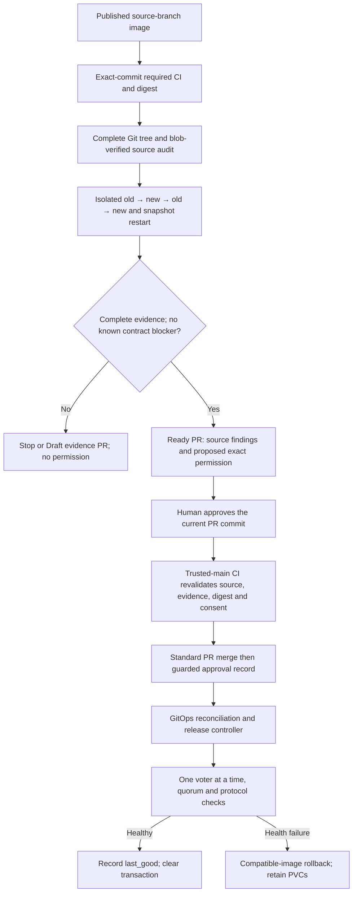

# Compatibility-qualified GitOps deployment

This opt-in reference implementation qualifies an immutable Elastickv image in
an isolated Kubernetes namespace, opens a bounded GitOps PR, validates its evidence,
and promotes the image through a serialized three-voter rollout only after an
allowed human approves that exact PR head. It also restores
the previous compatible image when production health checks fail. The controllers
never restore, delete or replace production data or backup PVCs.

This directory is independent of `deploy/kubernetes/kustomization.yaml`. Nothing
here is installed by the ordinary Kubernetes manifests. Published examples contain
placeholder images and no deployment approvals; both
CronJobs are suspended. `prepare.py` operates on local files only.

## Release path



An image push is not itself a deployment trigger. The source branch head must
have successful required CI at that exact SHA. The controller then verifies the
registry manifest/config digests and `linux/amd64` architecture. Newer unqualified
commits do not block an explicitly qualified ancestor on the configured source
branch. A retag cannot replace an already-qualified digest.

Every proposed release now requires an exact-head human PR approval, including
configuration/documentation-only releases. The source audit runs automatically;
operators no longer add manual `source-reviews.json` pairs. Historical pair records are not consulted by this version and cannot bypass
the new audit.

`source_review.py` compares the full immutable source inventories against GitHub's
comparison, reads bounded source archives without extracting or running candidate
code, and verifies each changed file against its Git blob hash. It records diffs,
source hashes, findings and limitations in `source-review.json`. Known protobuf
contract edits, removed/moved persistence readers, changed persisted version/magic
markers and unsupported feature-default activation block promotion. Dependency,
CI and persistence-logic changes are highlighted for the approving human.

This deterministic contract audit is a bounded automated risk assessment, not a
proof of arbitrary program semantics and not a claim that all compatibility bugs
can be recognized statically. Successful source CI, all isolated preservation tests
and human approval are independent requirements. A blocker or incomplete/truncated
analysis cannot be overridden by simply approving or marking a Draft ready; it
needs a separately designed, reviewed compatibility/migration profile.

Diagnostic gzip artifacts under the canonical `docs/evidence/` path are reported
as review attention rather than executable source. This narrow classification
requires non-executable regular files, a gzip header for nonempty blobs, and a `.pprof`, `.cpu`,
`.block`, `.mutex`, `.log.gz` or `.tar.gz` suffix on both sides of a rename.
They remain in the complete inventory and hash-verified archive and consume the
same file, byte and publication budgets. Nested contents are opaque: the audit
does not decompress or execute diagnostic archives or certify their contents.
Unknown binaries, executable/symlink modes, runtime paths, `.go`/`.proto` source
and independent persistence-removal findings are not exempt. Reviewers must still
check any runtime/build use of an artifact; its path does not prove non-use.

Within one changed file, the audit can match a unique constant marker rename that changes
only the first letter's export case, such as `snapshotVersion` to `SnapshotVersion`.
Its complete initializer and declaration kind must remain unchanged. Explicit
types must match; a standalone untyped decimal `const` may acquire a fixed-width
unsigned type only if that identical literal fits. Arbitrary renames, ambiguous
spellings, mutable variable renames or duplicate declarations cannot justify the exception. Value changes,
explicit type changes, removals and incomplete initializers still block. A matched
rename is recorded as attention, not a proof of call-site semantic equivalence.

Source review defaults to 200 changed tree paths. An explicitly reviewed profile
may set `source_review_limits.max_files` up to 1000. At GitHub's 300-file comparison
cap, complete old/new Git inventories supply every changed path; archive contents
must match their immutable blob hashes. Reported rename relationships are checked
against both trees and retained, including moves into persistence paths. Remaining
paths use conservative removal/addition analysis. Truncated trees, missing blobs and all byte/publication budgets
still stop qualification. Large reports may omit display excerpts while retaining
every file identity and finding; this never omits source analysis or blockers.
If a Go/protobuf implementation deletion is not covered by a verified rename,
an accompanying new persistence path blocks qualification: an omitted move cannot
be established safely. This can conservatively block independent deletion/addition
changes; they require a separate reviewed profile rather than an approval bypass.

For a one-time assembly refactor, a separately reviewed `relocation_profile` may
be installed in the trusted qualification configuration. It binds the repository,
exact old/new source SHAs, immutable application image, every classified deleted
nonpersistent implementation blob, all destination implementation blobs and a
review note per disposition. Splits and merges require every destination. It is
not a semantic proof or a blanket source-pair approval. Missing/changed blobs,
unregistered deletions, persistence-reader removals, wire/format/default-feature
blockers and all existing budgets remain fail-closed. Candidate code and machine
proposal branches cannot alter this trusted configuration.

A trusted operator may explicitly disposition a blob-bound nonpersistent assembly
relocation into a persistence package. This resolves only the conservative
unresolved-move finding; it does not establish semantic compatibility or waive
any independently detected persistence, wire, format or feature-default blocker.
Persistence-reader protection is based on the documented path prefixes, not a
semantic identification of every reader in the program. Review all destinations
and declaration/type bindings before approving installation of such a profile.

The profile can resolve only the uncertainty generated by its bound nonpersistent
deletions. The full changed-source analysis still runs and the report records the
profile digest and each resolved path as review attention. It selects only its
exact bootstrap target while the recorded baseline is active; the target must
still be on the configured source branch, pass its exact CI and provenance checks,
and receive fresh runtime evidence plus exact-head human consent. The profile
automatically retires when the accepted baseline advances. Default examples do
not install a profile. A deployment-specific profile and its declaration/move
review evidence belong in the operator's private GitOps repository, not here.

Release failures record only the exception class and, for HTTP failures, status,
method and query-free path. Readiness reasons are drawn from a fixed allowlist;
headers, credentials and arbitrary response bodies are never logged. These
diagnostics do not change health thresholds, retry failures or weaken rollback.

Acceptance starts a fresh continuous healthy window after a reported snapshot
restore or a confirmed healthy endpoint awaiting its Kubernetes probe condition.
This settling is bounded by the existing startup timeout. Every sample in the
final window must still pass the original readiness, Raft and ownership checks;
unknown HTTP failures, failed engines, lost ownership and invalid state remain
fatal. An unfinished restore cannot pass acceptance, and expiry triggers the
recorded rollback. No error body outside the allowlisted readiness reason is used
to authorize waiting.

The sandbox copies supported literal transport, FSM sync, snapshot-size and Redis
connection tuning, rejecting Secret references and invalid values. It preserves
the configured `sync`/`nosync` choice; synthetic round trips and snapshot restart
do not establish power-loss durability. Production settings are never changed by
qualification. Cache and snapshot-frequency overrides retain the documented
synthetic resource budget.

## Components and supported profile

| Component | Responsibility |
| --- | --- |
| `settings.py` | Validate site settings and require explicit configuration for live entrypoints |
| `agent.py` | CI/digest discovery, Git transaction ledger, Lease, quorum, canaries, rollout and rollback |
| `compatibility.py` | Read-only production inspection, isolated workload lifecycle and evidence branch |
| `compatibility_validation.py` / `compatibility_runtime.py` | Synthetic preservation tests without a Git key or production access |
| `compatibility_profile.py` | Runtime/qualification hashes, sealed storage and supported-layout checks |
| `source_review.py` | Complete source inventory, verified blobs, bounded contract audit and findings |
| `human_approval.py` | Human allowlist, current commit, dismissal/change-request and release-attestation checks |
| `compatibility_pr.py` / `check_elastickv_compatibility.py` | Trusted PR validation, exact-head server merge and guarded consent record |
| `prepare.py` | Render an offline GitOps scaffold without overwriting an existing repository |
| `register_elastickv_compatibility_volumes.py` | One-time operator registration of dedicated validation volumes |

The current profile supports exactly three Linux/amd64 voters named
`elastickv-0` through `elastickv-2`, an `elastickv` StatefulSet with `OnDelete`, the
`elastickv-peer` service, a `data` claim mounted at `/var/lib/elastickv`, and the
standard Redis/DynamoDB/S3/SQS ports. HTTP `/readyz` must be available on port 8081.
The existing [runtime readiness configuration](../kubernetes/examples/readiness/)
is mandatory. Use a compatible image for the initial baseline too. Qualification
requires readiness already enabled on the live baseline. Enabling or removing
readiness changes the runtime contract and requires a separately reviewed rollout;
it cannot be combined with an automatic qualified image update.

Production storage can use the provisioner selected for the existing application.
The supplied **validation storage adapter** deliberately requires NFS CSI
(`nfs.csi.k8s.io`) with three independently provisioned directories under a dedicated,
configured validation export root. It does not silently relax storage identity
checks for another driver. Add a separately tested adapter before using other
validation storage. The examples require three eligible nodes for anti-affinity.

This default profile does not enable encryption, commit-ts fence, timestamp
binding, Phase D, custom server flags, production init containers or lifecycle
hooks. Admission inspects every running voter as well as the StatefulSet template;
stale OnDelete Pod hooks, init/debug containers and unexpected claim bindings
stop qualification. Writable data sidecars and
unexpected/overlapping volumes are refused. FUSE workloads and custom application
hooks need a separate qualification profile.

## Prepare a site configuration

Use Python 3.12 or newer and a local virtual environment:

```sh
python3 -m venv /tmp/elastickv-automation-venv
/tmp/elastickv-automation-venv/bin/pip install -r deploy/automation/requirements.txt
cp deploy/automation/examples/gitops/automation/deployment.json /tmp/site.json
```

Edit `/tmp/site.json`. The full schema is the small `DEFAULTS` mapping in
`settings.py`; unknown keys are rejected. All three namespaces must be distinct.
Paths must be normalized repository-relative paths and must not overlap.

| Settings | Site-specific values |
| --- | --- |
| `source_repository`, `source_branch`, `application_image` | Source GitHub repository, release branch and untagged public GHCR image repository |
| `gitops_repository`, `gitops_branch` | GitOps GitHub repository and branch advanced through non-force Git writes |
| `control_namespace`, `production_namespace`, `validation_namespace` | Separate controller, application and disposable validation namespaces |
| `application_path`, `release_path`, `qualification_path`, `evidence_path`, `code_path` | Locations inside the GitOps repository |
| `backup_claims` | Nonempty list of existing protected backup PVCs in the production namespace |
| `storage_class`, `nfs_root` | Dedicated validation StorageClass and exact NFS export root |
| `commit_identity`, `bot_login` | Commit author/committer identity and permitted automatic PR account |
| `promotion_reviewers` | Nonempty allowlist of human GitHub logins permitted to approve promotion |

Example repository and email values cannot activate a controller. All live tools
require `ELASTICKV_DEPLOYMENT_CONFIG` to identify an explicit JSON file. That same
configuration is included in the qualification identity; changing it invalidates
cached proposals. Production namespaces, Git paths and identities are configuration,
not edits to controller source.

When upgrading this package, preserve the existing release ledger, approvals and
sealed volume registration. Update controller code, immutable image pins and
generated source hashes together in a reviewed change. The release policy's
`controller_sha256` must match the executing engine, and PR validation checks that
production and qualification use the same engine/image. Do not replace an existing
deployment with a fresh empty scaffold during an upgrade.

Build the controller image **from the same source package you vendor**. The build
also compiles the matching `cmd/raftadmin` client. Publish it to your own registry
and record its immutable manifest digest:

```sh
docker build --platform linux/amd64 -f deploy/automation/Dockerfile -t ghcr.io/example/release-controller:reviewed .
# Publish using your normal reviewed image workflow, then resolve its digest.
```

Render into a new empty directory. The baseline SHA and digest must describe the
currently healthy three-voter cluster; this is adoption of an existing deployment,
not an initial Raft bootstrap procedure.

```sh
/tmp/elastickv-automation-venv/bin/python deploy/automation/prepare.py \
  --config /tmp/site.json \
  --output /tmp/rendered-gitops \
  --controller-image "$CONTROLLER_IMAGE_WITH_DIGEST" \
  --baseline-source "$BASELINE_COMMIT_SHA" \
  --baseline-image "$BASELINE_IMAGE_WITH_DIGEST"
```

The output contains the vendored controller/tools, copyable workflows, isolated
validation manifests, suspended controller manifests, an empty permission policy,
and a sample application overlay. There is no environment-specific source history
or initial target SHA. Review the sample application and merge the required image,
readiness, services and `OnDelete` settings into **your existing** GitOps overlay;
do not overwrite its storage, networking or credentials with the sample.

Review `required_workflows` in the release policy against the source repository.
The supplied names match the Elastickv workflows. If using GitHub default CodeQL
setup, add its real `codeql_workflow_id` so the dynamic run can be identified even
when its display name differs from `CodeQL`. CI from PRs or a different source
branch does not qualify an image. The current registry resolver supports anonymous
pulls from a GHCR-style token endpoint; private application registries need an
explicitly reviewed authentication adapter.

Check the rendered manifests locally before committing them to your GitOps repo:

```sh
kubectl kustomize /tmp/rendered-gitops/apps/elastickv-release
kubectl kustomize /tmp/rendered-gitops/apps/elastickv-compatibility
```

Use your configured paths when they differ from these defaults. The Kubernetes
API is not contacted by `prepare.py` or `kubectl kustomize`.

## Install without granting a new release

Keep both CronJobs suspended throughout bootstrap. Configure your GitOps reconciler
(for example Argo CD or Flux) to reconcile the application and the two controller
paths from the configured GitOps branch. Image and ledger commits must reach the
live StatefulSet. The production StatefulSet must remain `OnDelete`; the release
controller alone decides when to replace a member. Preserve PVCs during pruning.
Create the control namespace before applying the controller resources.

Provide these Secrets separately; no credential values belong in the package or
in Git:

- `elastickv-github-app` in the control namespace: `githubAppID`,
  `githubAppInstallationID`, `githubAppPrivateKey`. The installation needs access
  only to the GitOps repository with contents write and metadata read. It creates
  evidence branches and repository dispatch events, not PRs or review approvals.
- `registry-pull` where needed in the control and validation namespaces for the
  controller/application images. Use normal `kubernetes.io/dockerconfigjson` data.
- `elastickv-api-credentials` in production for bounded production canaries, and
  an **independent synthetic** Secret of that name in validation. Its
  `credentials.json` has a `credentials` list containing `access_key_id` and
  `secret_access_key`. Never copy production credentials into validation.

The trusted GitHub Actions workflows use the repository-scoped `GITHUB_TOKEN`.
Keep default workflow permissions read-only. The proposal workflow requests PR/actions write and checks read. A separate
review-event dispatcher can start trusted-main verification, but cannot write
contents. Verification publishes an exact-head check with checks write. Only the
merge job receives contents write; it reads PR consent and check results again
immediately before advancing the branch. GitHub's repository setting for Actions PR
creation is a combined create-and-approve setting. Enabling it permits PR creation;
these workflows do **not** call the PR review approval API. Repository protections
still apply. The PR is merged with GitHub's standard merge API using the exact
reviewed head SHA. Closed PRs, moved heads and branch-rule rejections have no
fallback to a direct Git merge. Only this automatic merge commit uses the GitHub
App identity. Proposal and consent-record commits use `commit_identity` for both
author and committer.

After the server merge, a separate non-force commit records consent in the policy.
The controller rejects the unstamped proposal during this gap. This record and
the existing rollout ledger/image updates require operational Git writes by the
configured writer. A branch policy that forbids those writes is unsupported unless
the operator has explicitly configured that writer's operational permissions.
Do not weaken protections automatically or grant general bypass as part of this
installation. Confirm both standard PR merges and the existing operational writes
are permitted before enabling scheduling; rejection stops promotion.

The initial bootstrap sequence is:

1. Reconcile release RBAC, policy and site ConfigMap with its CronJob suspended.
   Reconcile validation namespace, quota, services, RBAC, site ConfigMaps and
   NetworkPolicies, also with its CronJob suspended. Review API/DNS egress rules
   for your CNI, API endpoint and DNS namespace.
2. Provision the three dedicated validation PVCs. With the NFS CSI driver, use a
   dedicated export root matching `nfs_root` and `subDir` containing
   `${pvc.metadata.namespace}/${pvc.metadata.name}`. Keep a namespace-specific
   directory boundary and use `Retain`/`onDelete: retain` for this validation
   StorageClass. See the [NFS CSI driver parameters](https://github.com/kubernetes-csi/csi-driver-nfs/blob/master/docs/driver-parameters.md).
   Claims must already be Bound; this bootstrap does not provision local disks.
3. Apply each `bootstrap/*.yaml` Lease once. These files are excluded from the
   Kustomizations so a reconciler does not reset an active Lease.
4. Set `ELASTICKV_DEPLOYMENT_CONFIG` to the reviewed GitOps `deployment.json` and
   run `register_elastickv_compatibility_volumes.py --context YOUR_CONTEXT --dry-run`.
   Inspect every volume/claim UID, owner, namespace and NFS path, including the
   production/backup exclusion. Then run without `--dry-run` once. It **creates**
   an immutable registration and a get-only ClusterRole for exactly three PVs;
   it never patches an old registration, mounts a volume or deletes data.
5. Confirm negative RBAC checks: qualification cannot patch production or read its
   Secrets; validation cannot access production; neither role can delete PVCs/PVs.
   Verify storage permissions permit UID/GID 65532 to use the dedicated directories.
6. Commit/review the vendored workflows and configuration in your GitOps repository.
   Check code/image hashes and initial ledger against the live baseline. Only then
   unsuspend qualification and release CronJobs in Git.

The runtime rechecks PVC/PV UIDs, owner references, CSI driver and exact dedicated
NFS path before each reuse. The synthetic cleanup Job is token-free and nonprivileged;
it erases only the three registered test roots after the prior workloads have
terminated. Treat registration failures as changed storage, not as a reason to
replace the immutable ConfigMap without investigation.

## Human approval and automatic promotion

After activation, the only normal operator action is **Approve the ready PR** from
an account in `promotion_reviewers`, after reading its source findings and runtime
evidence. GitHub's **Approve and run** button authorizes workflow execution; it does
not count as a PR review approval and never supplies promotion consent.

The [GitHub `pull_request_review` event](https://docs.github.com/en/actions/reference/workflows-and-actions/events-that-trigger-workflows#pull_request_review)
handler checks out only trusted default-branch code and
dispatches verification on the configured GitOps branch. It never executes the
proposal's code with write permissions. Verification targets `inputs.head_sha`
explicitly and publishes a check against that SHA; it does not mistake the
workflow's main-branch `GITHUB_SHA` for the approved proposal. Install the dispatcher
and its trusted code on the repository's default branch, even when the configured
GitOps branch differs.

Before merging, the tool requires a same-repository bot PR, a ready/open state,
successful exact-head validation and an effective approval from an allowed human.
Comment-only reviews do not erase a prior approval; dismissed approvals, wrong
commits, bots, stale heads and outstanding changes requested by an authorized
collaborator block promotion. Consent is read again before the standard PR merge
and before the subsequent approval record. Only policy and fresh evidence files
may be merged. GitHub checks PR state, exact head and branch rules on the merge
request. The following guarded commit inserts the review ID, human login, PR
number and approved head in the exact permission. It verifies the server merge's
parents and reviewed policy and refuses concurrent main changes. The release
engine rejects the unstamped intermediate proposal.

Changing a commit after approval requires a new review. Manually dispatching the
workflow or removing Draft status does not bypass consent or source/test blockers.
Approval can arrive before validation finishes; the promotion run revalidates all
gates. If baseline/configuration/volume identities change, it stops for fresh
qualification and approval instead of applying old evidence to a different cluster.
No production or backup data is mounted by this review path.

## Evidence, failure and reruns

Qualification preserves at least 128 baseline Redis keys, a candidate-written key,
consistent DynamoDB items, S3 payloads and SQS messages across old/new/old/new and
snapshot restart. Each phase needs at least two Ready voters and zero observer
errors. Native snapshot indices must be present before restarting candidate voters.
The suite uses a 700 MiB/cache/snapshot budget distinct from production and finite
synthetic data. It is not a production-data restore test or a proof for arbitrary
features, formats or datasets.

A successful branch includes the automatic source report and its digest, exact
source pair/image digest, runtime profile,
controller/driver hashes, full compressed observations and production Pod/claim
bindings. Trusted main-branch code revalidates the bounded diff and current baseline
before creating a PR and again before merging it. Only one exact permission can
be added. Existing approvals cannot be rewritten by a machine evidence PR.
A changed controller, reviewer implementation, setting, source assessment or
production identity needs a fresh qualification before a proposal can merge.
Drain active transactions and pending approved releases before upgrading controller
code/configuration; do not reuse their evidence across controller upgrades. Closed proposals are not reopened automatically.

Inspect the validation evidence ConfigMap, bot PR, dispatched `compatibility-review`
and `merge-qualified` checks, release Job, `release-state.json`, and all three Pods.
The explicitly dispatched trusted-main workflow is the validation gate even when
GitHub suppresses or holds a token-created PR event. A completed discovery Job can mean “waiting for
CI” or “waiting for the current release”; it does not itself mean a release occurred.
Acceptance requires the candidate as `last_good` and no active transaction.

Production retains its longer startup/healthy-window checks. Raft membership,
commit/application progress, snapshot progress, leader ReadIndex, follower-first
replacement, leader transfer and Redis/DynamoDB/S3/SQS canaries are checked during
rollout. The persisted transaction and Lease serialize recovery. Health failure
rolls back the compatible image and quarantines that digest. If the live Raft leader
fails readiness, rollback may use a normal leadership transfer only after two Ready
voters prove the expected membership, recent leader contact and fully applied
committed entries. The leader must answer RaftAdmin, and all three must agree on a
positive term and configuration index. Both Ready voters must cover its commit
index. Git ownership, the Lease, Pod identities/specs and PVC identities are checked
before transfer. Normal quorum and leader ReadIndex must pass on the new Ready
leader before any Pod deletion. This recovery path is restricted to a persisted
rollback transaction; forward rollout keeps the strict Ready-leader requirement.
Configuration drift
or lost ownership stops writes. PVC data is not rolled back; incompatible format
changes need a separately designed migration and cannot use this image rollback.
Existing backups remain protected; the controller does not create or refresh them.

If RaftAdmin is unreachable, membership/term/progress disagrees, a transfer cannot
be confirmed, or fewer than two Ready voters remain, stop without deleting another
Pod. Suspend scheduling in Git, wait for any active Job/Lease holder to finish,
and retain the transaction, evidence and failed Job logs. Restore connectivity and
the proven Ready majority before resuming the recorded rollback. Do not clear its
transaction, rebind/delete claims, remove voters, or force an election to bypass the
gate. A cluster without a provable majority requires a separate operator-reviewed
recovery using retained backups.

If the server merge succeeds but recording consent fails, the proposal is inert:
there is no new deployment permission. Preserve the qualification branch. Rerun the
same trusted workflow with the original PR number and head SHA while main still
points at the exact server merge. Recovery revalidates the original evidence,
source CI, consent and verified merge parents; it does not merge the PR again.
If main or controlled inputs advanced, stop for a fresh qualification and approval.
Never hand-stamp an approval or force-update main to recover.

For a qualification/release retry, retain failed Job logs/evidence, fix the cause and let the next schedule
run. To pause, suspend the relevant CronJob **in Git**. Suspension does not stop an
already-running Job. Wait for it to finish before changing controller code or
runtime configuration. For an operator-triggered run, first suspend its schedule
in Git, wait for active Jobs to finish, start one Job, and resume only after it
finishes. A manual Job is not sufficient evidence that the CronJob's active list
will prevent overlap; the Lease is the final ownership guard. See the
[Kubernetes CronJob concurrency documentation](https://kubernetes.io/docs/concepts/workloads/controllers/cron-jobs/#concurrency-policy).

## Local checks

```sh
/tmp/elastickv-automation-venv/bin/python -m unittest discover -s deploy/automation -v
```

Tests run offline with synthetic evidence and mocked GitHub/Kubernetes boundaries.
They cover failed rollout/recoverable rollback, ownership loss, retagging, stale
profiles, volume rebinding, unowned canary cleanup, trusted merge scope and identity,
custom namespaces/paths/branches, suspended rendering and publication isolation.
When `kubectl` is available, the tests render all three Kustomizations and reject
duplicate resources. The repository CI runs these checks with read-only permissions;
it has no publish, cluster or production deployment step.

The parameterized package requires its own staging run at the target site before
enabling automatic production promotion. Offline checks do not establish live
cluster, storage, registry credential or CNI compatibility.

### Signed application provenance

Every candidate digest must have a valid GitHub/Sigstore build attestation from
`provenance_workflow` in the configured source repository, at the exact candidate
commit and source branch, on a GitHub-hosted runner. The publisher uses
`actions/attest` after pushing the image. Qualification, trusted PR review and
release discovery each run `gh attestation verify` with the digest, repository,
workflow, source SHA and ref pinned. Missing or invalid attestations stop promotion;
a SHA-named registry tag alone never authorizes deployment. GitHub CLI is included
in the controller image with a pinned download checksum. Review workflows also
need a current GitHub CLI; controllers use their existing installation token for
public attestation lookup. No new application credentials are required.

The source publisher must be merged and publish a newly attested image before
this controller can qualify a candidate. Historical unsigned images may remain
as the already-installed baseline and rollback target, but cannot become a new
candidate. See [GitHub CLI verification](https://cli.github.com/manual/gh_attestation_verify)
and [artifact attestations](https://docs.github.com/en/actions/how-tos/secure-your-work/use-artifact-attestations/use-artifact-attestations).
