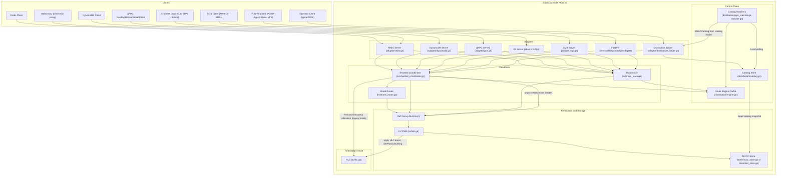
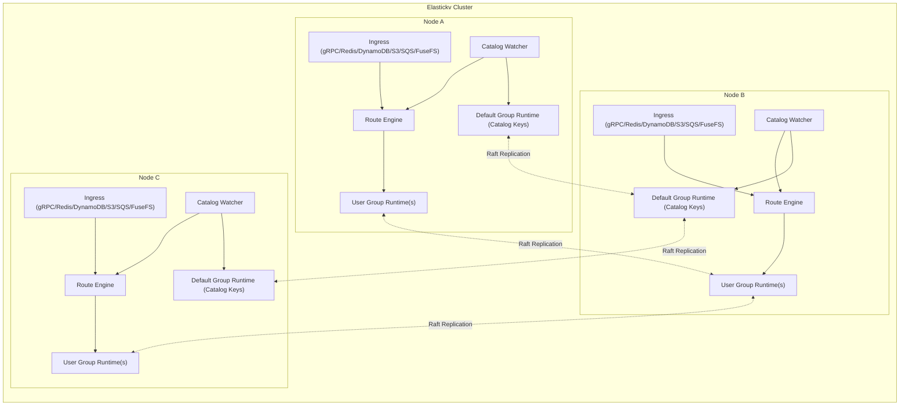
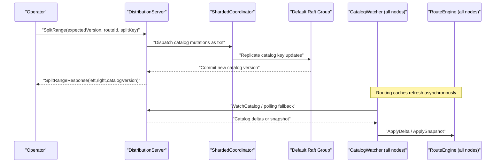
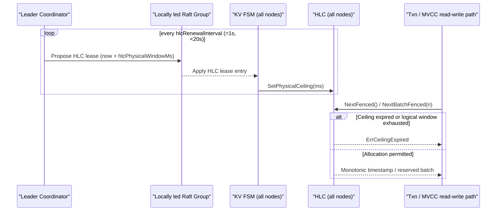

# Elastickv Architecture Overview

Elastickv exposes multiple protocol APIs over one sharded, replicated KV engine.
Start with the [high-level diagram in the README](../README.md#architecture) for the request flow, or the [Getting started guide](getting_started.md) to run a node.
The diagrams below expand that view into runtime components and cluster topology.

## Architectural layers

| Layer | Responsibility |
| --- | --- |
| Protocol adapters | Translate Redis, DynamoDB, S3, SQS, gRPC, and filesystem requests into KV operations. Each API has its own compatibility scope. |
| Routing and transactions | Resolve key ranges to Raft groups and coordinate transactional operations over those groups. |
| Raft replication | Order and replicate each group's changes through its leader and voting replicas. A group needs a majority of voters to commit. |
| MVCC storage | Apply committed changes to versioned local data, persisted in Pebble by the normal server. Each replica owns its local storage. |
| Route catalog | Persist range ownership in the default Raft group and refresh each node's routing cache. |

A **shard range** maps a portion of the keyspace to a **Raft group**.
A **node** is a server process that can host replicas for several groups; those groups can have different leaders.
Replicas of the same group contain replicated data, while different data groups serve their assigned ranges.
The single-node quick start runs one voting replica per configured group. To tolerate a host failure, place a three-voter group across independent hosts; the in-process demo does not provide those failure domains.
The shared engine does not imply cross-API record interoperability or a transaction spanning different protocol requests.

## 1. Component Diagram

Catalog mutations follow the coordinator → Raft → FSM path; the catalog store reads the applied snapshot.
The HLC arrows show the legacy timestamp mode. The optional dedicated group-0 timestamp oracle is described in the [TSO operations guide](centralized_tso_operations.md).

## 2. Overall Runtime Architecture

The topology illustrates separate catalog and user-group roles. Depending on configuration, the default group can also own user ranges; the quick start does not require a separate catalog-only group.

## 3. Same-group Control Plane Split Path

## 4. Hybrid Logical Clock (HLC)

In legacy timestamp mode, the coordinator uses a Hybrid Logical Clock (`kv/hlc.go`).
A 64-bit timestamp packs a 48-bit physical component (Unix milliseconds) and a
16-bit in-memory logical counter. Raft commits the physical-time ceiling.
Fenced allocation rejects an expired ceiling or an exhausted logical window;
callers must handle that error. The unfenced `Next()` helper is not a persistence safety check.

## 5. Notes

1. Route catalog is persisted in reserved internal keys in the default Raft group.
2. `distribution.Engine` is an in-memory routing cache. The normal server consumes the catalog leader's `WatchCatalog` stream (with a polling fallback) and also polls its local applied catalog. Watchers apply deltas or replacement snapshots; the split response does not wait for every node's cache to refresh.
3. `SplitRange` is same-group only. Cross-group split migration uses a separate job path (`StartSplitMigration`), omitted from this diagram. The opt-in `--autoSplitCrossGroup` scheduler uses that path for eligible right-child moves; see the [automation design](design/2026_06_11_implemented_hotspot_split_milestone3_automation.md).
4. In legacy mode, the sharded coordinator renews HLC ceilings through each
   locally led group. The logical counter advances in memory with no Raft
   round-trip. The normal server shares a `*HLC` instance between its
   coordinator and KV FSMs; see `internal/server/run.go` and
   `internal/server/shard_groups.go` for wiring.
