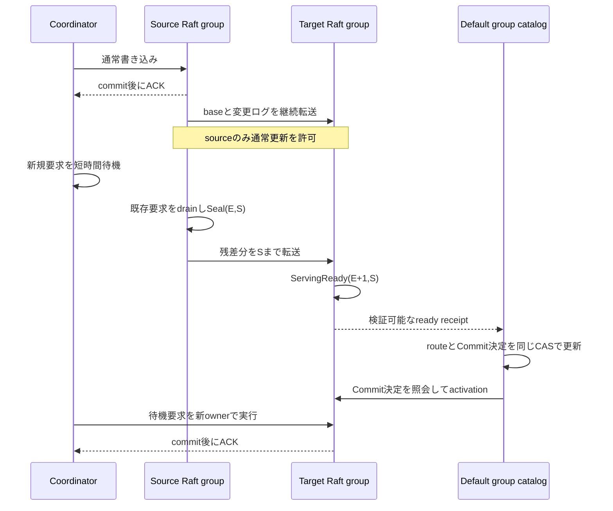

# Split中の書き込み継続

状態：提案。
対象コード：`c1b150441b8297fd528fe89b8f14d660389e8821`。
この文書は設計であり、オンライン移行の実装完了や性能達成を示すものではない。
Splitなしの通常時のプロファイル採取と性能改善は別の作業で進める。
RawKV point entryのshadow記録基盤については、[実装した範囲](2026_11_21_partial_online_split_capture.md)を別途記録している。

## 書き込み継続の契約

正常なクラスタでは、コピー中も移動範囲の書き込みをsourceで処理し、最後の所有権切り替えだけ短時間待機させる。
ここでいう継続は、クライアントからの要求受付と期限内の完了を目標とするもので、すべての瞬間にsourceかtargetが新規コミットを実行するという契約ではない。
移行だけを理由とする長い拒否区間を取り除き、ACKした値の欠落、二重適用、古い所有者による更新を防ぐ。

障害中も一定時間以内に成功するとは約束しない。
quorum喪失や結果不明の通信断は既存のエラー契約を維持し、未確認の書き込みを自動再実行しない。
「受付済み」という理由だけで成功を返さず、通常のRaftコミットとFSM適用を終えてからACKする。

最初に実装する経路はRawKVのpoint mutationとする。
ただし、同じrouteに入る他の更新を無視してオンライン移行を有効化することはできない。
移動対象の全familyと全更新経路に変更捕捉の対応があることをcapabilityで確認し、未対応の更新を検出した場合は、sourceの通常書き込みを優先してseal前に移行を中止する。
「RawKV対応」の検証と、混在するadapterを含むproduction有効化の判定を分ける。

## 現行実装が停止する区間

現行のcross-group移行は、sourceで書き込みを止めた後にdeltaをコピーする。
`adapter/split_job_runner.go`の`finalizeSplitJobFence`はcatalog上のfence、source各voterのapply確認、pending lockのdrainを進め、`commitSplitJobFenceState`でDeltaCopyへ遷移する。
DeltaCopyはその後に`(delta_floor, fence_ts]`を転送するため、差分量と転送処理の時間が書き込み停止区間に入る。

切り替え後にもtargetの準備が残る。
`cleanupVerifiedSplitJob`は所有権取得後のpromotionを進めるため、targetのserving readinessとstagedデータの可視性も書き込み再開に関係する。
sourceのfenceだけを短くしても、この準備区間は消えない。

既存のwrite trackerは変更内容のログではない。
`kv/fsm_migration_readiness.go`の`recordMigrationWriteInStates`が保持するのは、対象範囲で認めた`MinAdmittedTS`である。
これだけでは、sourceを動かしたまま「どこまでの変更をtargetへ反映したか」を追跡できない。

直前の[同条件試験](../evidence/rawkv_outcome_20261121/README.md)では、書き込みUnknownは解消した一方、移行中のUnavailableとAbortedは残った。
今回の設計は、この結果の分類に加えて書き込み可用性自体を改善するためのものである。
同一group内の論理splitは、新たなネットワーク転送経路へ変更しない。

## 方式の比較

| 方式 | 書き込みへの影響 | 安全性と実装上の条件 | 判断 |
| --- | --- | --- | --- |
| 現行deltaコピーの高速化 | 停止区間が差分量に依存する | 既存手順のまま改善可能 | 補助的な改善として継続 |
| 各要求をsourceとtargetへ同期送信 | 全書き込みがtargetの遅延や障害を受ける | 両groupの成否と再試行を調停する新たなcommit protocolが必要 | 初期案から外す |
| sourceの適用結果を非同期に追従し、最後だけseal | コピー中はsourceだけで通常commitできる | 変更ログの完全性、短い切り替え、epoch管理が必要 | 採用候補 |
| 長いfenceの間、要求をqueueに保持 | 停止時間が要求の待ち時間へ移る | メモリと期限の上限が必要 | 切り替え直前の短時間に限定 |

採用候補では、sourceを唯一の書き込み所有者として維持し、その適用結果をtargetの非公開データへ反映する。
sourceとtargetに通常要求をそれぞれ実行させる処理は導入しない。

## 所有権と変更順序

**所有権epoch**：routeの書き込み権限を識別する単調増加の番号。
job ID、source group、target group、route範囲、migration protocol version、namespace manifestのdigest、configurationの証拠と結び付ける。
既存のcatalog versionとownership partitionの証拠を置き換えず、その検証にepochとhandoffの決定を追加する。

**変更位置**：`(source lineage, job_id, generation, raft_index, ordinal)`で識別する適用済み変更の位置。
source lineageにはsnapshot restoreや再bootstrapで別のRaft履歴を混同しない識別子を使う。
`commit_ts`は元のMVCC可視性に使い、転送の進捗には使わない。
たとえば、先にprepareした低いtimestampのtransactionが後でcommitしても、apply位置が後なら変更ログに含まれる。

**seal receipt**：sourceのRaft状態が、epoch Eの新規データ変更を位置Sまでで閉じたことを示す永続証拠。
後続のsource適用で旧epochの更新を受け付けず、targetのcursorとdefault groupのhandoff決定が同じreceiptを参照する。
古いwatcherや古いleaderのメモリ状態だけではsealを解除できない。

次の不変条件を維持する。

1. Eのsourceがデータ更新を許可する期間と、E+1のtargetが通常更新を許可する期間は重ならない。
2. sourceで成功した対象変更は、baseに含まれるか、base後からSまでの変更ログに含まれる。
3. targetの通常更新は、base完成とSまでの連続適用、所有権のCommit決定、target側のactivation適用をすべて確認してから許可する。
4. sourceはdefault groupでAbortが確定し、新epochの再開権限を適用するまでsealを維持する。
5. targetのcursor更新とデータ反映、sourceの変更ログと通常データ更新は、それぞれ同じ永続化単位で行う。
6. 変更捕捉の欠落、構成不一致、未知のformat、未確認のhandoff決定があれば切り替えを進めない。

## コピー中の処理

### sourceでの原子的な変更捕捉

`store.RaftEntryApplier`を中心に、成功した適用結果の記録を追加する。
このinterfaceは既に、同じRaft entry内のデータ変更、readiness更新、applied indexを同じbatchへまとめる。
ただし、現行FSMがこのinterfaceを選ぶのはすべての通常要求ではなく、単一要求と一部の制御命令は別経路を通る。
複数要求でも共通batchへ入る条件は限定されているため、既存のscopeへjournalを追加するだけでは対応は完了しない。
新しい記録も同じbatchに入り、通常データだけが残る、または変更ログだけが残るcrash境界を作らない。
同じentry内の一部要求が決定的に拒否された場合は、成功した要求の結果だけを記録する。

記録するのは、再実行前のRawPutやRedis命令ではなく、適用が確定した転送可能な状態変更である。
MVCC version、tombstone、TTLの絶対期限、必要なtransaction状態を保持する。
prefix削除は、既存storeが生成する実際のversion変更または同値な決定的表現を捕捉し、空範囲の削除もcoverage上の完了として表現する。
targetで増分命令、条件付き更新、timestamp発行を再実行しない。
sourceの暗号文は物理キーに束縛され得るため、そのバイト列をtargetの別namespaceへそのまま書かず、認証された転送で論理キー、版、値、削除、期限を渡してtargetで再符号化する。

sourceで暗号化を有効にしている場合は、journalの値、WAL、snapshotにも通常データと同等の保存時保護を適用する。
論理値を取り出すことは、平文のjournalを永続化することを意味しない。
journalのAADをjob、generation、変更位置と論理キーへ結び付け、再送と復元に必要な鍵を、そのjournalとsnapshotの参照が残る間は保持する。
replicaごとの暗号文やnonceをcoverage digestや容量判定へ使わず、同じ論理表現からdigestと論理byte数を計算する。
通常データの鍵ローテーション後も未転送journalを復号できることを確認し、対応できるまでは暗号化構成でcapture自体を有効化しない。
ログとmetricsに値や復号済みpayloadを出力しない。

更新経路の監査は有効化の前提とする。
通常mutationだけでなく、prepareとcommit、abort、複数requestを含むentry、typed control command、TTL処理、各adapterの内部familyを列挙する。
Raft entry scope外で処理するtyped commandについても、対象状態を変更するなら同等の原子性が必要である。
peer-localなtimestamp protocol状態、Raftの構成、暗号鍵のローカル管理状態を、そのまま別groupへ複製しない。
既存のtransfer familyとrouteKey正規化を再利用し、未知のfamilyやdecodeできないキーを黙って除外しない。

連続性の証拠には、空の区間も含める。
対象変更がないRaft indexを単なる欠落と区別できるよう、exportは「このindexまで走査済み」というcoverageと、その区間のbatch digestを返す。
timestampや受信した最後のrowだけから、変更のない穴を越えたと推定しない。
ネットワークの応答とdigestだけを権限証明にせず、sourceで永続化したsessionと現在の構成に照合する。

### baseの一貫性

変更捕捉を開始する制御entryの適用と、その直後の一貫したstore snapshotを結び付ける。
必要なMVCC履歴と各familyの制御状態についてretention pinを先に適用し、baseと未転送journalの参照がなくなるまで保持する。
このsnapshotの適用位置Bをbaseの基準とし、全transfer familyを同じviewからページ分割して読む。
異なるページで最新storeへiteratorを開き直すだけの実装では、このbase契約を満たさない。
snapshot取得のためにapplyを長く停止せず、短いlatch区間でviewを開き、コピー自体はlatch外で行う。
このviewのindex Bより後の同じentry内のordinalを取りこぼさないよう、snapshotはentry全体のcommit後に開き、journalもentry完了のcoverageを持つ。

このroute-scopedな一貫snapshot exportは新規に実装する必要がある。
既存のgroup全体のsnapshot restoreをtargetへそのまま適用する案は採らない。
source以外のrouteやgroup-localな管理状態を上書きしてしまうためである。

snapshot handleはローカルな資源として扱う。
leader交代や再起動で同じBのviewを提供できなくなった場合、古いcursorで別のviewを読むことはせず、generationを更新してtargetの非公開baseを作り直す。
sealはbase完成後にしか許可しないため、このやり直し中もsourceで書き込みを続けられる。
各generationの変更ログ、snapshot pin、cursor、target側領域を区別し、古い転送応答を新generationへ混ぜない。
既存staged keyとpromotion cursorはjob ID単位であるため、既存formatを使う最初の実装では、baseを取り直すたびに旧jobをAbortして新job IDを割り当てる。
同じjob IDのgeneration番号だけを書き換えて、既存staged領域を再利用しない。
旧jobのImportとPromoteはtargetの永続した終端markerで拒否し、新jobへそのcursorや残存rowを引き継がない。

### targetへの追従

targetは通常の所有者として要求を受け付けず、job専用の非公開データへbaseを反映する。
base完成後、Bより後の変更をsourceの順序で適用する。
同じbatchを再送した場合はreceiptとdigestを照合し、同じ位置で異なる内容なら破損またはprotocol不一致として停止する。
targetで受信しただけではcursorを進めず、targetのRaft適用とデータ永続化を終えたcursorをsourceへ返す。

sourceが再起動してもjournalとsessionを復元できるよう、group snapshotとrestoreにも含める。
Raft WALの保持期間だけには依存せず、journal自体のGCはtargetの永続cursorとbase generationの証拠で行う。
sourceのRaft indexが残っているだけでは、移行ログの完全性を証明できない。
通常の同一lineage内のsnapshot復元と、別lineageへ再bootstrapする操作を区別し、後者では旧receiptを引き継いで公開しない。

targetが返す永続cursorは、対応するshadow本体、base manifest、receipt、phaseと同じtarget Raft snapshotに含まれるものに限る。
sourceは、この復元可能性をcapabilityと試験で確認したtargetのcursorだけをGCに使う。
古いbackupへの外部復元などでtargetのcursorがsourceのGC済み位置より戻った場合、欠落を飛ばしてactivationしない。
seal前は新generationでやり直し、seal後は必要な状態の復旧を行うまで公開を保留する。
activation後はtarget自身がACKした通常更新も存在するため、転送cursorがSと一致しているだけではserving再開の証拠にならない。
通常のRaft復旧ではtargetのコミット済み履歴まで追従してからservingを許可し、その履歴を証明できない外部backup復元では自動再開を禁止する。
sourceのjournalはSで閉じているため、targetのactivation後の更新をそのjournalから取り戻せるとは扱わない。

## 所有権切り替え

1. **CatchUp**：sourceはActiveのままbaseと変更ログを転送する。
   targetの永続適用速度が変更生成速度を上回ること、backlogが小さいこと、構成に変化がないことを継続して確認する。
2. **PrepareHandoff**：targetのbase完成、全familyのcoverage、時計の準備、現在の各voterのprotocol対応を確認する。
   既存のsource read fence、target readiness、ownership frontierの条件を満たせる見込みがない場合、この段階でsourceを止めない。
   sourceとtargetで後述のmembership holdを確定し、その構成に結び付いた証拠を使う。
3. **Drain**：coordinatorの新規未投入要求を上限付きで待機させる。
   sourceにepoch付きのDrain制御をRaft適用し、新規prepareと新規raw更新を止める。
   coordinatorのqueueだけに依存せず、現在の各voterがこのadmission fenceを適用したことを確認する。
   その後、既存prepareのcommitまたはabortだけを許可してdrainする。
   このdrain中に発生した変更もjournalへ含める。
   長時間transactionが残る場合はsealを行わず、後述のAbort決定とgate解除の手順でsourceを継続する。
4. **Seal**：sourceのRaft制御entryで旧epochを閉じ、最終位置Sと最終時計情報を確定する。
   coordinatorのgateを知らない古い入口からの要求も、source FSMのepoch検査で新規更新として適用されない。
   sealはユーザー要求に加え、転送対象状態を書き換える内部更新も閉じる。
   seal後のsourceに許すcleanupやcontrolは、Sで確定した転送対象状態を変えないものに限る。
   ここからはtargetに未反映の大きなbase転送や全件promotionを残さない。
5. **ServingReady**：targetがSまでの連続適用を終え、すぐに利用可能な読み書きviewを準備する。
   targetの時計floorは、sourceで既に発行され再利用され得るtimestampや予約範囲も含む既存のtimestamp protocolに従って設定し、最大imported commitTSだけで代用しない。
   sourceの新規readを止めるfenceとtargetのreadinessも、同じjobと期待cutover versionで現行voterへ適用してreceiptを揃える。
   sourceのactive read pinはcleanupまで保護し、sourceの新規read admissionが閉じた証拠をCommitの前提にする。
6. **Commit**：default groupの同じtransactionで、handoffのCommit決定とrouteの新所有者を確定する。
   このCASが所有権決定の順序点となる。
   targetはその決定を検証してactivationをRaft適用するまで通常要求を実行しないため、安全な空白期間は許すが所有者の重複は許さない。
7. **Serve**：coordinatorは最新の所有権とtimestampを取得し、再投入可能性を確認した待機要求をtargetへ送る。
   sourceはsealを維持し、古いrouteを使った要求には新しい所有者への照会を促す。
8. **Cleanup**：sourceのread drainとretention条件を満たしてから、旧データとjournalを段階的に回収する。

promotionの全件完了を、切り替え後の書き込み再開の条件にしない。
現行の`ShardStore`には既に、`StagedVisibilityActive`に従ってliveとstagedを合成するGet、scan、OCC検査、prefix削除の実装とテストがある。
この既存機能を利用できる場合、promotion自体は切り替え後の上限付き非同期処理として残せる。
targetは事前に読み書き可能なviewを準備し、activation時に所有権の証拠とviewへの参照を同じtarget applyで公開する設計とする。
MVCC versionとTTLを変えず、旧generationの遅延batchが新規の通常更新を上書きできないようにする。
オンラインhandoffに必要なviewの完成証拠やactivationは新規機能であり、既存の合成読み取りだけで既に満たしているとは扱わない。

| targetの格納方式 | 必要な証拠と制約 | 試作での扱い |
| --- | --- | --- |
| 既存stagedとliveの合成 | 開始前に移動範囲のliveが空で、旧prepare、旧read pin、他jobの遅延更新がないことを全familyで証明。activation後のpoint更新はliveへ書き、range削除のstaged効果も保護する | 専用のfresh targetを使うRawKVの最初の試作候補 |
| generationごとの物理namespace | 現役viewの全readとwriteをmanifestから解決し、旧namespaceへfallbackしない。再移動と旧版起動も扱う新しいstore formatが必要 | 非空の移動先や一般の再移動に対する候補 |

最初の候補では、targetが非所有者であることを確認してjob専用の事前準備guardをRaft適用し、そのguardの下でliveが空であることと旧readerやintentがないことを確認する。
guardの適用時に旧prepareが存在すれば、黙って破棄せずこの簡略経路の開始を拒否する。
単に移動先の`Get`がnilだったことや、最新timestampのscanが空だったことでは証明できない。
必要な全familyと保持中の履歴、既存job、解決例外を確認し、scan中や証明後にも旧処理がliveを更新できない状態を維持する。
検証は上限付きのページで行い、handoff中に全件scanを追加しない。
既存の合成処理を通らない読み書き経路があれば、その構成では採用しない。
activation後の通常更新と非同期promotionが同じMVCC版を上書きしないこと、staged削除とlive反映が原子的であることを追加試験する。
この条件を証明できない移動先へは、この簡略経路を使わずsourceで通常更新を続けて移行を延期する。

この候補でも、既存実装へ追加修正が必要な箇所がある。
`committedVersionAtForRoute`のexact-version照会はliveを先に読んでいるため、次のstaged照会との間にpromotionが入ると、実在する版を見逃し得る。
通常の`GetAt`と同じstaged優先の照会、または両方を同じsnapshotから読む方式に修正し、`RawLatestCommitTS`を含む決定的な競合テストを通すまで有効化しない。

prefix削除は、stagedにしかないキーを削除するためにstaged側へも通常更新のtombstoneを作る。
この効果を「baseとjournalの入力を閉じた」という理由で拒否または破棄しない。
通常更新はsourceの最終floorを超えるtimestampを使い、promotionとその後のretirementでもこれらの版を保持する。
「stagedだけにあるキーをprefix削除してACKし、その後promotionを完了してもキーが復活しない」を必須テストにする。

一般化する場合の候補は、jobのgenerationに対応する物理namespaceを作り、targetの所有権証拠が指すmanifestで解決する方式とする。
移行する論理キーとfamilyは保持し、物理配置だけを変える。
公開後のpoint read、scan、OCC、lock解決、TTL、新規書き込みは同じviewを使い、**新viewにキーがない場合に旧namespaceへfallbackしない**。
旧namespaceに値が残り、新generationで削除済みのキーが復活する経路をこの規則で閉じる。
複数routeを跨ぐscanは各範囲のviewを解決し、範囲を混ぜて旧領域全体をscanしない。
処理途中のtransactionがviewを混在させないpinと、次の移行で物理prefixを取り除いて転送する規則も必要になる。
同じgroupへの再移動、再split、crash後のmanifest復元を段階3の試作に含める。

`ServingReady(S)`をtargetに永続化した後は、同じgenerationへのbaseとjournalのデータ書き込みを閉じる。
受領済み位置の同一digestに対する再送には保存済みreceiptだけを返し、データを再適用しない。
Sを超えるbatch、異なるdigest、未知のgenerationは拒否する。
この検査はworkerの状態だけに頼らずtarget FSMで行い、activation後の新規ユーザー更新を古い同世代batchが上書きする経路も閉じる。
既存staged合成を採用する場合のpromotionは、凍結済みの同じMVCC版をstagedからliveへ原子的に移す別の制御操作として許可する。
新しいbaseやjournalの取り込みを再開する操作にはしない。
通常要求が生成した上記のstaged tombstoneも、そのcommitTSを保持して同じ原則で移す。

読み取りはsourceが所有している間はsourceへ送る。
targetの非公開データへ途中から通常読み取りを振り分けず、read-your-writesを保つ。
最後の切り替えでは既存のper-voter read fenceとactive read drainを維持し、新規読み取りには待機または確実な新ownerへの照会を使う。
sourceのpoint read、scan、明示group読み取り、followerを通る入口にもこの条件を適用し、targetがACKした後に旧sourceの値を返す経路を残さない。
再開時に古いreadTSと古いrouteをそのまま使わず、RawKVでは新たなread fenceを取得する。
transactionのsnapshotや複数routeのreadを透過的に再開始する機能は、初期のpoint write対応へ含めない。

### 構成変更とreceiptの有効期間

直前にcurrent voterをprobeしただけでは、次のcatalog CASまで構成が変わらないとは証明できない。
初期protocolでは、短いhandoff区間だけ構成変更を保留する**membership hold**をsourceとtargetへ永続化する。
holdはjob、generation、範囲、ownership epoch、configuration indexに結び付け、両groupが安定した構成でholdを確認できるまでgateとsealを開始しない。
既にjoint configurationへ入っているgroupでは、この短いhandoffを開始しない。

holdはRaftのmembership変更を単にapply時に無視する機能ではない。
engineのmembership proposalとholdの受付を同じ順序で調停し、先行するconfiguration変更が完了してからholdを確定し、それ以後の変更提案を保留する。
leader交代後も、committed holdを適用してからmembership提案を許可する。
既存のコードにはこの調停があると仮定せず、engineとcontrolの新しい契約として実装する。
hold中に予期しない構成変更を観測した場合は、そのreceiptでcatalog CASを行わず、決定を照会して再証明またはAbortへ進む。

default groupへ渡すready証拠は、sourceのsealとtargetの連続適用に加えて、両groupのholdとconfiguration indexも束ねる。
それぞれを認証された内部RPCとleaderの適用済みreadで照合し、leaderの自己申告や受信済みrow数で代用しない。
hold中のready状態はCommitまたはAbortの決定まで単調に維持し、任意のworkerが先にcleanupできないようにする。
holdの解除にも同じ排他的決定を使う。
障害時のmembership変更が必要になった場合は、安全なAbortまたはCommit後の復旧手順を優先し、時間制限だけでholdを消さない。

## 短時間の待機と再投入

待機は、データ要求をまだ提出していない位置で行う。
対象は`ShardedCoordinator`のroute admissionとし、各adapterに専用queueを作らない。
module内部でroute範囲、job、epoch、要求の期限、dispatchの状態を保持し、呼び出し元に新しい移行手順を要求しないinterfaceにする。
同じgroupにある移動対象外のpoint要求を同じqueueへ入れず、captureや非公開viewの準備だけでgroup全体のserving floorを未来のcatalog versionへ進めない。
複数範囲を読む要求が移動範囲に交差する場合は、その要求全体の既存整合性契約に従って待機または拒否を判定する。

要求は次の状態を区別する。

| 要求の状態 | 許可する処理 |
| --- | --- |
| まだデータ要求を提出していない | 上限付き待機後、新ownerを照会して初回提出 |
| 全dispatchが未投入または完全な非commitと証明済みの単一Raw point要求 | 試行数と期限の範囲内で再照会 |
| sourceへ提出し、応答が不明 | 待機queueへ戻さずUnknownを維持 |
| 複数requestや複数groupの一部だけ拒否が確認できた | 全体を再提出しない |
| 元のtransactionが既にprepareやcommitを開始 | 既存transaction recoveryで解決し、新ownerで別transactionとして再実行しない |

既存のnonadmissionとindexed apply rejectionの証拠は、この区別に再利用する。
「最後の試行だけが非commit」では再投入を許可せず、それ以前の全試行も含めて判定する。
移行ログの再送用IDとクライアント要求の重複排除IDは目的が異なるため、同一視しない。

queueにはrouteごととprocess全体の件数上限、byte上限、待機時間上限を設ける。
初期試験値はrouteごと256件または4MiB、process全体4096件または64MiB、handoffの待機目標500msとする。
これは未測定の出発値であり、通常時のp99と既存2秒RPC期限に対する余裕を測って調整する。
件数、payloadの保持量、キャンセル処理、timerの数を含めて計測する。

queueは永続的な受付台帳ではない。
coordinator停止時にqueueが失われても成功済みと扱われず、クライアントから見たRPCの失敗を既存契約で返す。
取消と送信の競合には`Waiting -> Dispatching -> Submitted -> Resolved`の状態を使い、`Waiting`からの原子的な取消が送信より先に確定した場合だけ未投入と判定する。
`Dispatching`以後に期限切れになった場合、ローカルtimerだけでは未投入を証明できず、実際の送信と既存のdispatch証拠から結果を分類する。
満杯時にプロセス全体を止めず、未提出と証明できる要求だけに限定したbackpressureを返す。
満杯や期限超過は「無停止達成」と集計しない。
同じキーに対する重なった要求の完了順は既存の整合性契約に従い、ACK済み要求の後続が古いepochで適用されないことを保証する。

## 障害と中止の決定

handoffの決定はdefault groupのjobに`Preparing`、`Committed`、`Aborted`の排他的な状態として保存する。
この状態は、sourceのseal receiptとtargetのready receipt、次のowner epoch、期待catalog versionに結び付ける。
CommitとAbortは同じjob revisionを条件とするCASで競合させ、一方が成立した後に他方を成立させない。
`Preparing`はオンラインjobの開始時に作成し、最初のcaptureとholdの要求より先に永続化する。
Commitには両方のreceiptを要求するが、Abortにはseal receiptもready receiptも要求せず、片側のholdしか取得できていなくても決定できるようにする。
このjobのすべてのAbortでsourceの所有権epochをE+1へ進め、CatchUp中や片側holdだけの場合も例外にしない。
default groupはAbortとsource所有routeのE+1を同じtransactionで確定し、sourceがReopen authorizationをRaft適用した位置で旧Eの新規受付を閉じる。
それ以前のsourceは、元のActiveまたはDrainまたはSealedの状態を維持する。
元からActiveだった場合、同じsource group内のepoch切り替えであり、targetへの公開は発生しない。
既存prepareの解決規則は、下記のseal前Abortの規則をすべてのAbortに適用する。
オンラインjobを作成する前の候補調査やcapability検査の中止では、所有権epochを変更しない。

| 発生箇所 | 復旧または中止の処理 |
| --- | --- |
| 一方のhold取得後、他方が停止 | receiptが揃わなくてもdefault groupでAbortを確定し、取得済みholdを解除 |
| base転送またはCatchUp中のtarget停止 | sourceで通常更新を継続し、転送を再開またはjobをAbort |
| snapshot handle喪失 | seal前なら新generationでbaseを再作成 |
| journal上限接近、未対応の更新検出 | sourceの通常更新と同じapplyにcapture-invalidを保存し、そのjobのsealを禁止してAbortへ進む |
| Drain開始後、seal前に長時間transactionを検出 | Commitへ進めず、排他的Abort決定とgate解除を確認してsourceを継続 |
| Seal後、Commit前のtarget停止 | default groupでAbortが確定した場合だけsourceの新epoch再開を許可。決定不明ならsealedを維持 |
| Commit CASの応答喪失 | linearizableに決定を読み直す。timeoutをAbortと推定しない |
| Commit後、target activation前の停止 | targetのactivationを再開。sourceを旧epochで再開しない |
| targetの通常更新開始後 | 新ownerでforward recovery。sourceへの自動rollbackを行わない |
| voter変更、learner昇格、joint configuration | receiptの構成を再検証。必要なvoterの未対応や未反映をleader ACKで代用しない |

seal後のsource再開には、新しいepochを発行する明示的なAbort authorizationが必要である。
default groupのAbort決定とsource所有routeの更新を同じtransactionで行い、sourceの現行voterがその決定に対応する再開制御を適用するまで通常更新を許可しない。
ネットワークから受け取った自己申告のcatalog versionやjob IDだけでは再開できない。
古いCommit処理、古いseal receipt、遅延したtarget ready応答は、新しいepochを上書きできない。

Abortの適用には、片側だけ取得したholdからの復旧も含める。
まずdefault groupでAbortを確定し、各到達可能groupのquorumでその決定と終端markerをRaft適用してholdを解除する。
終端markerの後に届いた同じjobとgenerationのHold、Drain、Seal、Importは拒否する。
故障voterのACKをhold解除の条件とせず、その後に通常のRaft手順で必要なmembership交換を行う。
sourceの再開は交換後の現構成で証明し、故障voterの交換をそのvoterのACK待ちで禁止する循環を作らない。
sourceのquorum自体が失われている場合は、この解除も進められない。

seal前に長時間transactionを理由としてAbortした場合も、admissionのepochはE+1へ進める。
残っている旧epochのprepareについては、保存済みintentのtransaction ID、primary、participantと一致し、同じsourceが所有者であることをAbort authorizationで確認できるcommitまたはabortだけを解決可能にする。
一般の旧epoch raw要求や別transactionに、この例外を与えない。
prepareの解決結果と元のtimestampは保持し、新規要求に対するclock floorとは区別する。
一方、Sealのapplyには対象範囲のprepareが解決済みであるという永続状態の検査を要求する。
seal後は既存のresolution例外を通常ownership検査より先に通さず、Sより後の対象データ変更を作らない。
既に完了したcommitの再照会は保存済み結果の返却だけを許し、新しいデータ効果を発生させない。

500msの目標を超えたからといって、sealをローカルに解除することはできない。
目標超過を検知した場合も、既に通過した段階に応じて上記の決定を確定する。
障害中に安全性を維持した結果、要求が期限を超える場合は、その失敗を試験結果に含める。

## 負荷と資源の上限

変更ログはsourceの追加WAL量とtargetのreplay負荷を増やす。
bytes/sec、適用entry数/sec、targetの永続cursor、backlog bytes、最古未転送位置の経過時間を測り、catch-upが収束している場合だけhandoffへ進む。
通常負荷の変動に応じて転送のbatch数とbyte数を制限し、長いapplyや一括promotionを作らない。

移行用の容量を使い切る前にsourceでcapture-invalidを永続化し、通常書き込みを維持したまま移行を中止する。
通常なら受け付ける値が転送側のsize上限を超える場合も、seal前は移行をinvalidにしてその通常書き込みを維持する。
既存のtransfer-size guardが移行のために通常要求を拒否する経路を、そのままオンラインprotocolへ流用しない。
通常の要求サイズ上限や永続化失敗の扱いは維持し、転送できないrowを黙って省略したままsealしない。
一度invalidになったjobを、cursorだけ進めて有効へ戻さない。
容量判定はreplicaごとの空き容量に基づく非決定的なFSM分岐にせず、複製されたjob上限と決定的な記録量に基づける。
実際のローカルdisk障害は通常の永続化障害として扱い、片方のreplicaだけがjournalを省略する動作は許さない。

移行が無効のrouteでは、journal本体の走査や割当を発生させない。
既存のserving summaryとroute範囲のindexを使い、全jobの履歴を各書き込みでscanする実装を避ける。
sourceごとの同時移行数とsnapshot保持時間にも上限を設け、容量が不足する場合は新規Splitを延期する。

## 実装の分割

| 段階 | 変更箇所 | 完了条件 |
| --- | --- | --- |
| 1. 原子的な変更捕捉 | storeの全apply経路、typed apply、journal暗号化、snapshot保存と復元 | user data、journal、applied indexのcrash原子性、全writer coverage、鍵ローテーション後の復元を確認 |
| 2. 継続転送 | 内部RPC、generation、source export、target receipt | baseとjournalの欠落、重複、順序逆転、leader交代を検出し、cursorを再開可能 |
| 3. targetの事前準備 | 既存staged合成またはgeneration view、clock floor、activation | promotion完了をwrite再開条件にせず、旧データや再送と通常更新が競合しない |
| 4. 排他的handoff | SplitJobの新protocol version、source seal、membership hold、default決定、ownership gate | CommitとAbort、voter変更、応答喪失を含めて所有者重複なし |
| 5. 短時間待機 | coordinatorのadmission、キャンセル、noncommit証拠の集約 | Unknownを再実行せず、未投入要求を上限内で新ownerへ提出 |
| 6. Linuxでの有効化判定 | 負荷生成器、履歴検証、障害注入、profile | 下記の正しさと性能条件を満たす |

旧jobのphaseやcodecを読み替えて、このprotocolを途中から使わない。
新しいjobと永続formatにprotocol versionを付け、必要なsource、target、default groupのcurrent voterの対応を開始前に確認する。
learnerもcatch-up中にlogとsnapshotを適用するため、capabilityの確認は全apply memberへ行い、未対応ノードをAddLearnerする前にも拒否する。
最初は明示opt-inとし、未対応の構成ではsourceがActiveな段階でオンライン移行を開始しない。
既存jobの復旧、abandon、cleanupを維持する。

sourceで最初のcapture状態を永続化する前に、必要なstore formatとprotocolの最小versionを永続化し、旧版の起動制限を有効にする。
journalが存在する間に旧版で通常更新だけが進む経路を作らない。
公開済みgeneration manifestが残る場合も、job完了後まで最小versionを保持する。
未対応ノードのserving、learner追加、昇格、snapshot install、旧版バイナリでの再openを拒否し、既存memberのバイナリ差し戻しにも適用する。
未知の新規metadataキーを追加するだけでは旧版に理解を強制できないため、既存の検証済みconfiguration envelopeと起動時のformat gateを拡張する。
実際の旧版バイナリを使うnegative試験で拒否を確認し、guardを理解する版の先行配布が必要ならformat activationより前に全台へ配布する。
公開formatの互換性条件を、一時的なmembership holdの解除と一緒に消さない。

最初の実装PRは段階1に絞り、変更捕捉をshadow検証する機能までとする。
これだけでオンラインSplitを有効化しない。
段階3の格納形式と段階4のhandoffを小さな状態モデルで検証してから、段階2以降を接続する。

## 検証と採用条件

正しさの検証には、成功した書き込みの最終readbackだけでなく、移行中の操作履歴を使う。
同じキーへの更新、削除と再作成、TTL、空prefix削除、route境界を跨ぐprefix、遅延した低timestamp commit、prepared transactionを含める。
同じsourceまたはtarget groupの移動対象外routeも継続して読み書きし、range単位のgateがgroup全体の停止へ広がっていないことを確認する。
RawKVの単一操作はlinearizabilityで確認し、transactionは既存のOCCとcross-group commitの契約に従って別に検証する。
まだ未投入の待機要求と、既に適用済みだが応答を失った要求を、障害注入で明確に区別する。

小さな状態モデルでは、source seal、target ready、default CommitまたはAbort、target activation、source再開、leader交代、古い応答の再到着を列挙する。
二重owner、ACK済み変更の欠落、S未満のcursorでのactivation、Commit後のsource再開が到達不能であることを調べる。
実装テストでは、各永続化境界の直前と直後で停止し、snapshot restoreとRaft再送後の一致を確認する。
片側holdだけのAbortとvoter交換、未解決prepareを残したAbort後の解決、source journal GC後のtarget復元、activationと通常更新後の同世代batch再送も必須ケースにする。
段階1からcapture中のsourceを旧版で再起動する試験を行い、段階3以降は公開済みstoreの旧版起動も確認する。
既存staged合成の候補では、exact-version照会中のpromotion、prefix削除後のpromotion、新job IDでのbaseやり直しと旧job batchの遅着を必須ケースにする。

性能はSplitなしとSplitありを同じLinux構成で比較する。
まず既存の3 node、2 group、1KiB、read/write各50%、並行数32、2秒RPC、同期永続化を固定し、100、200、300、400、500要求/秒を段階的に試す。
新規セッションの通常時改善によってbaselineが変わった場合は、使用commitとbinary hashを固定し直す。
CPU、alloc、mutex、block、WAL bytes、apply時間を取る診断試行と、profile無効の正式試行を分ける。

| 指標 | 採用時に確認する条件 |
| --- | --- |
| 移行由来の書き込み失敗 | 非飽和の正常系でUnavailable、Aborted、Unknownが増えず、全予定要求を完了 |
| 非飽和時の成功ops/sec | 取りこぼしを隠さず、offered rateを維持 |
| 通常時の追加負荷 | online protocol無効時のops/sec低下5%以内、p99悪化10%以内を暫定目標とし、複数試行で判定 |
| コピー中の遅延 | journalとreplayによるp95とp99の増分を記録。500msのhandoff目標とは別に評価 |
| 最後の待機 | gate開始から新ownerでのdispatch再開までを直接計測。暫定目標500ms、未達なら未達として記録 |
| 期限と上限 | queue満杯、キャンセル、最大byte量、scheduler drop、capacity dropを全件計上 |
| 移行の収束 | backlogの推移、replay速度、準備時間、seal時間、Done時間を分けて記録 |
| 移行中の整合性 | 履歴検査と全ACK監査に欠落、重複効果、古いownerでの更新なし |
| 応答の分類 | gRPC codeとErrorInfo.reasonを保存し、Unknownを再試行で消していないことを確認 |

既存の500要求/秒試験は並行数上限でdropが発生するため、それ単独で「書き込みを止めない」とは評価しない。
非飽和条件の全要求成功と、飽和条件でのbackpressureの両方を確認する。
長いtransactionや障害を含む場合は、安全な移行延期または復旧を採用条件とし、正常系の短時間待機の値と混ぜない。

## 参照する実装

- `adapter/split_job_runner.go`：現行fence、delta、cutover、cleanupの手順。
- `adapter/split_job_working_source.go`：移動範囲のsource childとcatalog fence。
- `kv/fsm_migration_readiness.go`：既存write trackerとminimum timestamp。
- `kv/fsm_migration_promote.go`、`store/migration_promote.go`：段階的promotionとその上限。
- `store/raft_entry.go`、`store/raft_entry_memory.go`：entry単位の原子的な適用。
- `kv/migration_serving.go`、`store/migration_serving_admission.go`：ownershipとreadinessのserving admission。
- `kv/mutation_nonadmission.go`、`kv/migration_apply_rejection.go`：単一Raw dispatchの未投入と確定中止の証拠。
- `proto/distribution.proto`：既存SplitJobとphaseの永続形式。
- [既存のcross-group移行設計](2026_06_11_implemented_hotspot_split_milestone2_migration.md)：既存のread fence、時計、per-voter確認、cleanupの契約。
